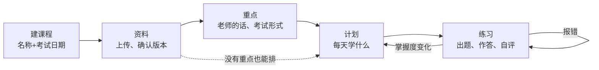

# 前端交互设计（WebUI v0）

状态：设计稿 v0，2026-11-24。依据 `设计修订v2.md`（下称 v2）和 `设计摘要.md`。本文只写前端要做什么、怎么交互；数据和接口见 `docs/接口合同/api-v0.md`。

## 0. 范围与平台

| 项 | 决定 | 理由 |
|---|---|---|
| 本期形态 | WebUI，单用户，本机运行（后端同源提供静态页） | 没有鸿蒙设备；Web 能最快把核心流程跑通 |
| 技术 | 原生 HTML/CSS + ES modules，不用框架、不需要构建、没有第三方依赖 | 不触发“新增依赖须先问”；移植到 ArkWeb 时可原样加载 |
| 布局 | 移动端优先（竖屏 360 起），宽屏加侧栏 | 最终产品在手机/平板上 |
| 后端未就绪时 | 前端自带演示数据层，按接口合同实现；探测不到后端时自动切换，并在角落标“演示数据” | 前后端并行开发，互不等待 |
| 鸿蒙适配 | 见第 7 节 | |

本期覆盖 P0：上传资料 → 老师重点与考试形式 → 复习计划 → 出题、作答、批改、报错。跨课程知识网络（P1）、校内层（P2）不在本期 UI 内。

## 1. 核心流程

- 四步是**建议顺序，不是门槛**。没填重点也能出计划（标“依据有限”）；资料还在后台解析也能先填重点。
- 课程页打开时，落在“下一个该做的步骤”：没有资料→资料；有资料没计划→计划；有计划→计划（按天，今天在最上面）。

## 2. 信息架构

| 路由 | 页面 | 唯一的主要动作 |
|---|---|---|
| `#/` | 课程列表 | 新建课程 |
| `#/c/:id/materials` | 资料 | 上传资料 |
| `#/c/:id/focus` | 重点 | 分析老师的重点 |
| `#/c/:id/plan` | 计划 | 生成/重排计划 |
| `#/c/:id/practice` | 练习 | 出一套题 |
| `#/c/:id/exam/:eid` | 作答（沉浸，隐藏导航） | 提交本题 |
| `#/c/:id/exam/:eid/result` | 本套结果 | 按结果重排计划 |
| 助手面板（叠在课程内各页上） | 备考助手 | 发送 |

导航：手机上课程内用底部四个标签（资料 / 重点 / 计划 / 练习），顶栏显示课程名和“还有 N 天”；宽屏（≥ 960px）改为左侧栏，列出课程和四个步骤。四个步骤带序号，因为它们确实是一个顺序；每个步骤旁有状态点（未开始 / 进行中 / 完成 / 需要你看一下）。

## 3. 交互准则

1. **一屏一事。** 每页只有一个实心主按钮；其余操作用文字按钮或行内菜单。
2. **文字克制。** 按钮 2 到 6 个字，用动词（“上传资料”“生成计划”“提交”）；说明最多一行；理由、出处、提示默认收成一个小标签，点开再看。
3. **结果先行，过程后置。** 页面先给结论（今天学什么、这题对不对），依据和细节折叠在下一层。
4. **不阻塞。** 后台任务（解析、分析重点、出题）只显示状态和进度，不弹遮罩；用户可以离开再回来。
5. **询问可以忽略。** 版本判定、资料角色、边界知识点“可能也包括”都做成行内建议卡，预选最可能的选项；不理会就按默认走。只有课程画像（考试形式）这类会长期改变行为的设置需要点“确认”（v2 2.9）。
6. **每个结论带依据。** 级别、重要度、考试形式旁都有来源标签：老师、笔记、作业、你标记的、默认（猜的）。没有证据时显示“依据有限”，并给出补充入口。
7. **状态一律显式。** 每个异步对象只有这几种状态：排队、处理中（带进度）、完成、需要你确认、失败。失败必须带一个能点的动作（重试、换一种方式），不出现只有“出错了”的死胡同。
8. **可撤销优先于确认。** 固定、取消固定、标记边界知识点都立即生效并可撤回；只有删除资料、删除课程用确认（会级联删除，不可恢复）。
9. **动作名称前后一致。** 按钮叫“生成计划”，完成提示就叫“计划已生成”。
10. **动效只回应操作。** 展开、勾选、提交后的反馈有短过渡（≤ 200ms）；不做进场动画；尊重“减少动态效果”。

## 4. 各页面

### 4.1 课程列表

- 每门课一行：课程名、考试日期、还有几天、当前进度（四个状态点）。按考试日期排，最近的在上。
- 空态：一句“先建一门要考的课”加“新建课程”按钮。
- 新建：底部弹层，两个字段（课程名、考试日期，日期可空）。

### 4.2 资料

- 顶部：上传区（手机上是按钮，宽屏可拖放）。支持 PDF、PPT/PPTX、DOC/DOCX、TXT、MD，可多选。
- 建议卡（如有）：放在列表上方，最多同时展示 2 张，其余折叠成“还有 N 项待确认”。
  - 版本：“这两份像是同一课件的不同版本”，两个选项，预选证据最强的那份。
  - 资料角色：“这份像是老师的复习题讲义”，选项“按老师重点处理”/“当普通课件”。
- 资料行：文件名、页数、类型标签（课件/作业/笔记/复习题讲义/往年卷）、状态。状态文案：
  - 上传后几秒：“已读取文字”
  - 处理中：“整理知识点 40%”
  - 后台：“图示补充中”（不影响使用，灰色）
  - 完成：不显示状态，只显示“32 个知识点”
  - 失败：“读取失败：文件加密”+“重新上传”
- 行操作（菜单）：改类型、删除（确认）。被版本取代的旧版收进“旧版本（2）”折叠组。

### 4.3 重点

两块，从上到下：

**老师说了什么。** 一个多行输入框，提示语举两个例子（“银行家算法一定考大题”“RAID 不考”）。主按钮“分析重点”。分析后每句话变成一张卡：

- 卡片标题是老师的原话。
- 下面列出落到的知识点，用**荧光笔**表示级别：强调 = 实心荧光底；提及 = 荧光下划线；不考 = 铅笔删除线。这是本应用最主要的视觉记号，在计划和题目里保持同一含义。
- “可能也包括”的知识点用虚线框，点一下加入、再点移除（立即生效，可撤回）。
- 课件里没找到：卡片底部一行灰字“课件里没找到对应内容”，不报错。
- 同一知识点“不考”与“强调”冲突：卡片上出现一张建议卡，请用户二选一。

**考试形式。** 题型（单选、填空、计算、简答、证明、设计）各自的题量和分值，时长，是否开卷。默认值预先填好，顶部一个来源标签（“默认（猜的）”“老师说的”）。用户改过任意一项后，来源变为“你填的”，出现“确认”按钮；确认前出题仍按旧设置。没有任何依据时，试卷上标“题型分布为默认设置”。

### 4.4 计划

- 顶部一行设置：“还有 [12] 天 · 每天 [3] 小时”，数字可点改，改完出现“重排计划”。
- 依据有限时一条提示：“老师重点很少，计划主要按内容量排” + “去补充重点”。
- 两种视图，分段切换：
  - **按天（默认）**：今天在最上面并展开，其余日期折叠。每项是一个主题：标题、分钟数、类型（学习/练习/复习错题/模拟卷），左侧勾选完成。
  - **取舍**：三组——必学、有时间再学、本次放弃。每组标题旁写总时长。
- 主题行展开后：理由标签（“老师强调”“作业考过”“是银行家算法的前置”“老师说不考”“依据有限”）、老师强调的知识点（荧光笔记号）、掌握情况（“7 个里掌握 4 个”的细条）。
- 行内操作：“固定必学”“放弃”“取消固定”，立即重算，toast 提示“已固定，计划已更新”+“撤销”。
- 预留时间（约 20%）作为“模拟卷与错题”出现在按天视图的最后几天。

### 4.5 练习

- 列表：每套题一行（标题、题数、得分或“进行中”），主按钮“出一套题”。
- 出题弹层：题量（5 / 10 / 20）、范围（计划里的必学 / 全部 / 错题相关），一个“开始出题”。
- 出题是渐进的：建好后立刻进入作答页，已出好的题可以先做，没出好的显示“出题中”。

### 4.6 作答

- 沉浸页：顶栏只有“退出”、进度（3/10）和题号点阵（已答/未答/出题中/验证中一目了然）。
- 一次一题，左右翻页（键盘 ← →）。
- 题目下方一行小标签：出处（“第四章 p.23”，点开看原页）、验证提示（如有，例如“依据只来自图示转写”）、“未经检查”（如适用）。
- 作答方式按题型：
  - 单选：点选项后“提交”，立即判分，正确选项变绿，选错的变红。
  - 填空：输入后提交，代码判分。
  - 计算：可输入最终答案（可空）；提交后展开解析，最终答案由代码比较，过程对照评分点自评。
  - 简答、证明、设计：可写可不写，点“看解析并自评”；评分点逐条三选一（答到了 / 部分 / 没答到），实时累计得分。
- 解析：编号步骤，数值和表格按块渲染；每步的出处是可点的小标签。
- 报错：题目右上角旗标 → 弹层选类型（答案错、解析错、超纲、题意不清、出处不对）+ 一句可选说明 → “提交报错”。提交后这道题对你隐藏，提示“已隐藏这道题，复查后会通知你”。
- 最后一题后：“完成本套”。

### 4.7 本套结果

- 得分、用时。
- 掌握度变化：按主题列出“不稳 → 掌握”这类变化。
- 主按钮“按结果重排计划”；次要“回看错题”。

### 4.8 备考助手（对话）

表单和对话并存：表单快、不耗模型额度、模型不可用时照常工作；对话负责讲解、口头信息的整理和“帮我改一下”这类请求。

- **入口：** 课程内任何页面，手机上是右下角的“问助手”按钮，点开是占屏 85% 的面板；宽屏（≥ 960px）是右侧 400px 的面板，可收起。作答页把入口放在顶栏。对话按课程保存，切换页面不中断。
- **知道你在看什么：** 每条消息附带当前页面、试卷、题目，用户可以直接说“这题”“这个”。
- **空对话时**给 3 个与当前页面相关的示例（计划页：“我只剩 3 天，每天 2 小时”；作答页：“这题怎么想”）。
- **过程可见：** 查课件、重排计划这类步骤显示为一行灰色进度（“查课件：银行家算法”），完成后保留为记录。
- **出处：** 讲解下方列出页码标签，点开看原页，与题目出处同一个组件。
- **动作卡片：** 助手执行的操作显示为一张卡片：做了什么、“去看看”、“撤销”。撤销后卡片变灰并写“已撤销”。对应页面自动刷新。
- **提案卡片：** 考试形式、删除资料这类改动显示变更前后对照，“确认”“不用了”。
- **做题时：** 先给思路和出处；用户明确要答案才给，这道题标“看过答案”，答对也不计为做对。
- **出错时：** 消息下方一行红字和“重试”；已经执行的动作保留。

## 5. 视觉规范

主题是“试卷与荧光笔”：冷白的纸、蓝黑墨水的字、黄色荧光笔标重点、红笔批改。

| 名称 | 值 | 用途 |
|---|---|---|
| 纸 | `#F4F6F9` | 页面底色 |
| 卷面 | `#FFFFFF` | 内容面板 |
| 蓝黑墨水 | `#1B2440` | 正文 |
| 钢笔蓝 | `#2F4BD6` | 主按钮、链接、焦点 |
| 荧光黄 | `#FFE04A` / 浅 `#FFF1A6` | 强调 / 提及 |
| 红笔 | `#D6423A` | 错误、报错、答错 |
| 绿笔 | `#1F8A5B` | 答对、掌握 |
| 铅笔灰 | `#6A7287` | 次要文字、不考删除线 |

- 字体：标题用宋体（Noto Serif SC / Songti SC，像试卷抬头）；正文和界面用 HarmonyOS Sans SC / PingFang SC / Noto Sans SC。数字用等宽数字。
- 字号：13 / 15 / 17 / 22 / 28。正文 15，行高 1.6，行宽不超过 38 个汉字。
- 圆角分层：按钮 10，面板 14，标签 6；面板之间用留白区分，不叠阴影。
- 状态色只用于状态，不做装饰。

## 6. 前端状态模型

- 每个异步任务是一个 Job（接口合同第 3 节）：`queued → running → done | failed | needs_input`。页面在有未完成 Job 时每 1.5 秒轮询一次，离开页面即停止。
- 视图只读接口返回的数据，不在前端计算重要度、计划或判分（这些都是后端代码的职责，见 v2 3.1、3.5）。前端唯一的“计算”是显示用的格式化。
- 用户动作一律乐观更新 + 失败回滚并提示原因。

## 7. 鸿蒙适配

| WebUI | ArkUI 原生对应 | 说明 |
|---|---|---|
| 路由（hash） | `Navigation` + `NavDestination` | 页面一一对应 |
| 底部标签 | `Tabs`（`barPosition: End`） | |
| 资料上传 | `DocumentViewPicker` | ArkWeb 内上传用 `onShowFileSelector` 接管 |
| 底部弹层 | `bindSheet` | |
| 列表、折叠组 | `List` + `ListItemGroup` | |
| 作答页与解析 | **ArkWeb 加载本仓库 `web/` 的作答页** | 题目的表格、代码、公式块渲染复用；v2 规定新题型只能用固定内容块，所以不需要加载外部脚本 |
| 演示数据层 | 鸿蒙端用接口合同样例渲染 | |

建议路线：先用 ArkWeb 整体套壳跑通 P0（成本最低），再把列表、计划等高频页面逐步换成 ArkUI 原生，作答页保留 ArkWeb。

## 8. 本期不做

公式排版（KaTeX，属新增依赖，确认后再加；现在公式按等宽文本块显示）、拍照上传答案、录音、跨课程知识网络页、校内层页面、深色模式。
