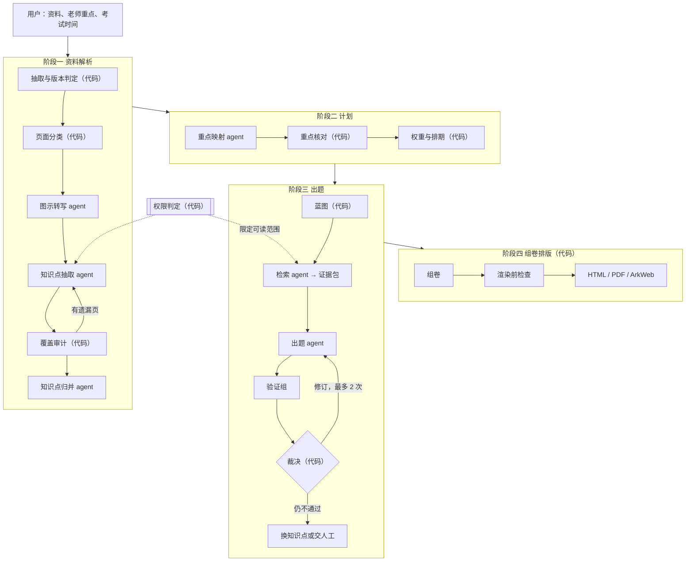

# 单一模型的 Agent 工作流设计

状态：设计稿 v1，2026-11-07。适用于原型和鸿蒙版后端。第 1 到 5 步已在原型中实现（见第 12 节）。2026-11-08 三轮回归评测：对因拦截平均约 43%，误报约 12%，结论见 `docs/评测/稳定性报告.md`。

## 1. 目标与约束

**目标：** 用户只有一个模型、模型能力可能一般时，仍然能稳定完成：资料解析 → 三级知识检索 → 复习计划 → 出题与验证 → 组卷排版。

**约束：**

- **单一模型：** 不假设用户能提供多个强模型。设计里的“多个 agent”指同一个模型在**不同上下文**中的独立调用。
- **权限不交给模型：** 三级知识的访问范围由代码判定，任何 agent 都不能扩大。
- **鸿蒙端只负责展示：** 模型调用、验算代码执行、渲染前检查都在服务端完成。
- **原型阶段不限制额度：** 不设输出长度、调用次数和上下文上限。文中的轮次上限只用来防止死循环。

## 2. 设计依据

### 研究结论

- 没有外部反馈时，模型很难自我纠正推理错误，修改后还可能变差（Huang 等，ICLR 2024）。
- 多 agent 辩论通常比不过“独立作答多次再投票”的 self-consistency，而且模型容易被同伴说服，把正确答案改错。
- 能用固定流程完成的任务，优先用固定流程，只在确实需要自主决策的环节使用 agent（Anthropic，Building Effective Agents）。

### 原型实测（2026-11-06）

| 轮次 | 题数 | 结论正确 | 有问题 | 被复核拦下 |
|---|---|---|---|---|
| 第一轮 | 29 | 29 | 5 | 0 |
| 第二轮（加强提示词和复核） | 29 | 29 | 4 | 0 |

9 道问题题的答案都对，错在解析、中间表格、定义或选项。原复核只比较“盲答答案是否与标准答案一致”，所以全部放过。

### 由此得出的原则

1. **流程由代码编排，** 不设“总管 agent”。
2. **信息隔离：** 每个检查只看它需要的信息，看不到会带偏它的内容。
3. **外部验证优先：** 能用程序判断的，不交给模型判断。
4. **独立采样代替辩论：** 多次独立作答后比较，不让它们互相讨论。
5. **按风险分配检查：** 计算题和证明题多查，简单概念题少查。

## 3. 总体架构



### 角色一览

| 编号 | 角色 | 类型 | 能看到的信息 | 产出 |
|---|---|---|---|---|
| R1 | 抽取与版本判定 | 代码 | 原始文件 | 按页文本、版本组 |
| R2 | 页面分类 | 代码 | 文本量、图片数 | 是否需要图示转写 |
| R3 | 图示转写 | 模型 | 页面图片和该页文字层 | 图表、公式、表格的文字描述 |
| R4 | 知识点抽取 | 模型 | 一份课件或其中一段 | 知识点、术语、页码 |
| R5 | 覆盖审计 | 代码 | 页码与知识点映射 | 遗漏页清单 |
| R6 | 知识点归并 | 模型 | 知识点标题和术语 | 标准知识点映射 |
| R7 | 重点映射 | 模型 | 老师重点原文、知识点列表 | 重点片段 → 知识点 |
| R8 | 权限判定 | 代码 | 用户、课程、策略 | 可读资料集合 |
| R9 | 检索 | 模型 + 工具 | 只在可读范围内检索 | 证据包 |
| R10 | 出题 | 模型 | 蓝图要求和证据包 | 结构化题目草稿 |
| R11 | 程序验算 | 代码 | 验算代码 | 执行结果 |
| R12 | 盲解代码 | 模型 + 代码 | 题干和资料，看不到答案 | 独立验算结果 |
| R13 | 独立作答 ×N | 模型 | 题干和资料，看不到答案 | 作答结果 |
| R14 | 逐步核对 | 模型 | **单个解析步骤**和证据页，看不到题目结论 | 支持、矛盾或资料中没有 |
| R15 | 选项反驳 | 模型 | **单个错误选项**、题干和资料 | 能否用资料原文证明该选项也正确 |
| R16 | 引用核对 | 代码 | 步骤、引用原文和页面 | 原文是否真实存在 |
| R17 | 裁决与路由 | 代码 | 所有检查结果 | 通过、修订或放弃 |
| R18 | 组卷与渲染 | 代码 | 通过的题目 | 试卷、答案、答题卡 |

模型角色共 9 个，都是同一个模型；其余都是代码。只有 R9 检索需要自主决定下一步。

## 4. 阶段一：资料解析

已有实现：抽取、版本判定、图示转写、知识点抽取（见 `docs/原型/原型说明.md`）。新增或调整三处：

### 4.1 页面分类（R2，代码）

上一轮把 1904 页全部送去图示转写，只有 807 页（约 42%）补充了内容。改为先分类：

| 页面类型 | 判断依据 | 处理方式 |
|---|---|---|
| 纯文字 | 文字量足够、无图片 | 不转写 |
| 含图表或公式 | 有图片或矢量图形，或含 Symbol 字体字符 | 转写 |
| 文字很少 | 文字层少于阈值，如本例中只有“0 1 0/1”的位示图页 | 转写 |

阈值按实测调整。也可以拿已有的 1904 页结果直接标定：807 页有内容，其余没有。

### 4.2 覆盖审计（R5，代码）

把知识点的页码与课件页码对比，找出有实质内容、却没被任何知识点引用的页，交给 R4 只针对这些页补抽。这样能防止长课件中段被漏掉，不需要靠模型自觉。

### 4.3 知识点归并（R6）

- **输入：** 同一课程的知识点标题和中英文术语；按课件分批，每批规模由模型档位决定（见第 9 节）。
- **输出：** `{知识点 id → 标准知识点 id}`，同时说明合并理由。
- **代码校验：** 被合并的两项至少要共享一个术语，或者标题相似度超过阈值；否则退回，或标记为待用户确认。
- **约束：** 英文或数字术语不同的知识点（如 FIFO 和 LRU）不允许合并，沿用现有规则。

## 5. 阶段二：三级知识检索

### 5.1 权限前置（R8，代码）

每次检索前先算出用户的可读范围：个人资料，加上校内授权文本，再加上共享开放文本。检索工具只在这个范围内工作，**agent 没有任何绕过的途径**。这部分已在原型的 `store.py` 中实现，并有测试覆盖。

### 5.2 检索 agent（R9）

这是唯一的自主 agent，因为“证据是否够用、下一步换什么查询”需要边看边决定。

- **工具：** 只有三个只读工具：`search(query, course, k)`、`read(material_id, pages)`、`points(course)`。
- **循环：**
  1. 根据知识点标题和术语，生成中文、英文和同义词查询。
  2. 检索并阅读候选页。
  3. 判断证据是否覆盖知识点的定义、关键步骤和例子；不够就换查询。
  4. 输出证据包。
- **停止条件：** agent 判断证据充分，或连续两轮没有新增有效页。另设 6 轮上限防止死循环。
- **证据包：**

```json
{
  "kp_id": "kp_xxx",
  "evidence": [
    {"material_id": "material_xxx", "page": 44, "tier": "personal", "role": "definition", "why": "给出 T0 时刻分配表"},
    {"material_id": "material_xxx", "page": 48, "tier": "personal", "role": "example", "why": "试分配过程"}
  ],
  "gaps": ["课件没有给出请求超过剩余需求时的处理"]
}
```

- **代码校验：** 证据中的页必须真实存在，且在可读范围内；`gaps` 原样传给出题 agent，避免它补出资料里没有的内容。

### 5.3 三级合并（代码）

| 来源 | 用途 | 规则 |
|---|---|---|
| 个人资料和老师重点 | 决定考试范围和主要权重 | 题目考点必须属于当前课程 |
| 校内信号 | 微调权重 | 最多调整 0.2 |
| 共享信号 | 微调权重 | 最多调整 0.1 |
| 校内或共享授权文本 | 可作为证据 | 证据包里标注 `tier`；个人资料与其冲突时，以个人资料为准 |
| 个人跨课程链接 | 只用于解析 | 不能成为考点 |

信号的聚合、上限和撤回全部由代码完成，不经过模型。

## 6. 阶段三：复习计划

### 6.1 重点映射（R7）

现在的老师重点匹配只靠词语重叠，“银行家算法要会算”这种口语表达容易漏掉。改为：

- **输入：** 老师重点原文、本课程知识点列表。
- **输出：** 每条映射写明它对应重点原文中的哪个片段，以及哪些知识点 id。
- **代码校验：** 片段必须真实出现在重点原文中；知识点 id 必须存在。
- **反馈：** 映射不到任何知识点的重点片段，提示用户“老师提到的 X 在课件里没找到”。这也能帮学生发现资料缺漏。

### 6.2 权重与排期（代码）

沿用现有实现：按章节分配时间和题量，按内容量分配每个知识点的时长，并列出未安排的知识点。

## 7. 阶段四：出题与验证

### 7.1 蓝图（代码）

决定每道题的知识点、题型、难度和分值，并给每道题分配**风险等级**：

| 风险等级 | 题型 |
|---|---|
| 低 | 概念类单选、判断 |
| 中 | 简答、论述、概念对比 |
| 高 | 计算、推导、证明、算法执行过程（填表、模拟） |

### 7.2 出题 agent（R10）

输出结构化草稿，**解析拆成编号步骤**，并为每一步标注出处。这样后续不需要再由模型拆分解析，也能逐步核对。

```json
{
  "item_id": "q_xxx",
  "kp_id": "kp_xxx",
  "type": "calculation",
  "stem": [{"kind": "text", "md": "设 X=ABCBDAB，Y=BDCABA……"}],
  "options": null,
  "answer": {"text": "2"},
  "steps": [
    {"id": "s1", "md": "递推式：若 X_i=Y_j，L[i][j]=L[i-1][j-1]+1，否则为 0。", "refs": [{"material_id": "m1", "page": 5, "quote": "longest common substring"}]},
    {"id": "s2", "md": "计算得到下表……", "table": {"header": ["", "B", "D"], "rows": [["A", "0", "0"]]}, "refs": []}
  ],
  "checks": [{"name": "L[5][2]", "value": 2}, {"name": "max", "value": 2}],
  "verify_code": "def solve():\n    ...\n    return {'answer': 2, 'L[5][2]': 2, 'max': 2}",
  "source_refs": [{"material_id": "m1", "page": 5}]
}
```

- **`quote`：** 资料中的原文片段，由代码核对是否真实存在。
- **`checks` 和 `verify_code`：** 高风险题必须提供；`checks` 要覆盖解析中出现的中间结果（表格、数值、序列）。
- **选择题：** 只写选项内容，不写序号；答案用选项序号表示。序号和选项打乱由代码完成。

### 7.3 验证组

每项检查都在独立上下文中运行，彼此看不到对方的结论。

| 检查 | 适用风险 | 输入 | 判定规则 | 对应实测问题 |
|---|---|---|---|---|
| **V1 程序验算**（R11） | 高 | `verify_code` | 在沙箱中运行，结果要与 `answer` 和全部 `checks` 一致 | 最长公共子串表格中算错的一格 |
| **V2 盲解代码**（R12） | 高，且可计算 | 只给题干和证据，要求写出求解代码，再由代码执行 | 结果要与标准答案一致；不一致时说明题意可能有歧义，或标准答案错误 | 防止出题代码和标准答案犯同样的理解错误 |
| **V3 独立作答 ×N**（R13） | 低 1 次，中 2 次，高 3 次 | 只给题干和证据 | 全部一致才通过；多数不一致则失败；一半一半时标记为可能有歧义 | 答案错误、题目歧义 |
| **V4 逐步核对**（R14） | 全部 | **只给一个步骤**及其引用页，不给题干结论和其他步骤 | 有任何步骤“与资料矛盾”就失败；关键步骤“资料中没有”则警告 | B(T) 定义与课件不符；拿单次结果和平均值比较 |
| **V5 推导连贯**（R14 变体） | 证明、推导 | 给出前 k 步，判断第 k+1 步能否由前面的步骤和资料推出 | 有一步推不出就失败 | 证明跳步；用上界论证下界 |
| **V6 选项反驳**（R15） | 选择题 | **每个错误选项单独一次**：尝试论证它也是正确答案，并引用资料原文 | 引用原文经 V7 确认真实存在，且论证成立，就判为存在歧义 | 渐变维度题里类型 6 也成立；错误选项是判断句 |
| **V7 引用核对**（R16） | 全部 | 各步骤和反驳中的 `quote` | 原文必须在对应页中找到（允许少量空白和标点差异）；只能在图示转写里找到时，降级为警告 | 编造出处 |

**V6 要求引用原文，** 是为了抑制模型“什么都能论证”的倾向：没有真实原文支持的反驳一律不算数。

### 7.4 裁决与修订（R17，代码）

- **直接失败：** V1 或 V2 结果不一致，V3 多数不一致，V4 或 V5 发现矛盾，V6 歧义成立，V7 引用原文不存在。
- **警告：** 关键依据只来自图示转写，非关键步骤在资料中没有依据。警告不阻止出题，但在答案页标注。
- **修订：** 把失败项的具体说明交给 R10，只修改出问题的步骤或选项；最多修订 2 次。
- **仍失败：** 换同章节的另一个知识点重出；全卷替换超过 30% 时，提示用户检查资料质量。

### 7.5 按风险路由

| 风险 | 运行的检查 | 每题估计调用次数 |
|---|---|---|
| 低 | V3×1、V4、V6、V7 | 约 3 + 步骤数 + 错误选项数 |
| 中 | V3×2、V4、V7 | 约 4 + 步骤数 |
| 高 | V1、V2、V3×3、V4、V5、V7 | 约 6 + 2×步骤数 |

**升级规则：** 低风险题如果 V3 与标准答案不一致，或 V4 出现警告，就自动补跑中风险检查。

估算：解析按 4 到 6 步计，每题约 8 到 18 次调用，现在是 3 次。逐步核对的上下文很短，单次调用的 token 远少于出题。实际用量要用回归集实测（第 11 节）。

### 7.6 验算沙箱

验算代码由模型生成，必须隔离执行：

- **运行位置：** 只在服务端运行，鸿蒙客户端从不执行模型生成的代码。
- **限制：** 独立子进程，无网络，只有临时目录；10 秒超时，并限制内存。
- **语法检查：** 执行前做语法树检查，只允许 `math`、`fractions`、`itertools`、`functools`、`collections`、`heapq`；禁止 `open`、`eval`、`exec`、`__import__`、属性反射和其他导入。
- **原型阶段：** 在本机子进程中运行；产品阶段放进容器。

## 8. 阶段五：组卷与排版（代码）

**模型不生成任何 HTML 或排版指令。** 题目在出题阶段就是结构化的，排版完全由代码完成。

### 8.1 内容块

| 块类型 | 字段 | 渲染 |
|---|---|---|
| `text` | Markdown，公式用 `$...$` | Markdown 加 KaTeX |
| `table` | header、rows | HTML 表格 |
| `code` | 语言、代码 | 等宽字体代码块 |
| `formula` | LaTeX | KaTeX 独立公式 |

### 8.2 渲染前检查

- 逐个编译公式，出错时只把这个字段退回 R10 修改。
- 表格每行列数一致。
- 选项不出现序号；选项之间不重复。
- 没有空字段，也没有残留的 Markdown 标记错误。

### 8.3 组卷

- 按题型分组，组内按难度递增排序。
- 按蓝图分配分值，并核对总分。
- 可选 A/B 卷：打乱选项顺序，答案键同步变换。
- 输出三份内容：试卷、答题卡、答案与解析（含出处页码和警告标注）。
- 同一套 HTML 用于 ArkWeb 展示和导出 PDF。

## 9. 模型档位适配

用户第一次配置模型时运行一组小测试，例如对 3 份课件抽取知识点并检查 JSON 格式，结果决定档位，之后可手动调整。

| 参数 | 强 | 中 | 弱 |
|---|---|---|---|
| 知识点抽取单位 | 整份课件 | 每 20 页 | 每 8 页 |
| 归并批大小 | 整门课 | 每份课件 | 每 30 个知识点 |
| V3 独立作答次数（高风险） | 3 | 3 | 5 |
| 检索 | 自主检索 agent | 自主检索 agent | 改为固定流程：按术语生成查询，取前 k 页 |
| 出题 | 一次输出完整草稿 | 一次输出完整草稿 | 分步：先题干和答案，再步骤，最后验算代码 |
| 格式错误重试 | 2 次 | 3 次 | 3 次，并把字段拆小 |

**原则：** 模型越弱，单次任务越小、采样越多、代码检查越多。流程不变，只调参数。

## 10. 数据契约

各阶段之间只传结构化数据，并由代码校验格式：

| 契约 | 产生者 | 消费者 |
|---|---|---|
| `EvidencePack` | R9 | R10、R14 |
| `ItemDraft` | R10 | 验证组、R18 |
| `CheckResult` | V1 到 V7 | R17 |
| `Verdict` | R17 | R10（修订）、R18 |

```json
{
  "item_id": "q_xxx",
  "round": 1,
  "checks": [
    {"check": "V1", "status": "fail", "detail": "checks.L[5][2] 期望 2，代码结果 2，解析表格写为 1", "target": "s2"},
    {"check": "V4", "status": "pass", "target": "s1"},
    {"check": "V6", "status": "warn", "detail": "选项 D 无原文支持的反驳", "target": "option_3"}
  ],
  "verdict": "revise",
  "issues_for_writer": ["步骤 s2 的表格中 L[5][2] 应为 2"]
}
```

这些契约会加入 `schema/` 下的 JSON Schema，并沿用现有校验脚本。

## 11. 评测

### 11.1 验证组回归集

回归集共 34 道题（`data/regression/items.json`）：第二轮 29 道原样导出；第一轮的原始结果已被 `--fresh` 删除，只按人工核对记录重建了 5 道问题题。其中 9 道有问题，25 道人工核对时结论正确、也没有标出问题。每道问题题的缺陷类型：

| 缺陷类型 | 数量 | 应拦截的检查 |
|---|---|---|
| 计算或表格中间值错误 | 1 | V1 |
| 推理错误或跳步（如用上界论证下界） | 2 | V4、V5 |
| 定义或说法与课件不符 | 2 | V4 |
| 步骤遗漏（如银行家算法少一步检查） | 1 | V4、V5 |
| 选项歧义或格式不当 | 2 | V6 |
| 不当比较（单次结果与平均值） | 1 | V4 |

**指标与目标（暂定）：**

- **拦截率：** 9 道中至少拦下 7 道。
- **误报率：** 25 道中不超过 3 道。
- **每题调用次数和 token：** 记录下来，用于确定风险路由。

误报的题需要人工复看：有时会发现之前漏看的问题，这时更新标注，而不是直接算作误报。

### 11.2 其他评测

- **检索：** 沿用 28 条查询的评测，并补充三级权限场景。
- **覆盖审计：** 统计补抽前后的知识点数和遗漏页数。
- **重点映射：** 人工写 10 条口语化重点，检查映射准确率。
- **真实效果：** 收集到真实期末卷后，测试知识点覆盖率和超纲率。

## 12. 实施顺序

按实测差距从大到小排列：

| 顺序 | 内容 | 验收 |
|---|---|---|
| 1 | 结构化 `ItemDraft`：解析拆步骤，加入 `quote`、`checks`、`verify_code` | Schema 校验通过，旧题可转换 |
| 2 | V1 程序验算、V2 盲解代码、沙箱 | 回归集中计算类问题被拦下 |
| 3 | V4 逐步核对、V5 推导连贯、V7 引用核对 | 推理和定义类问题被拦下 |
| 4 | V6 选项反驳 | 选项类问题被拦下 |
| 5 | R17 裁决、修订和风险路由 | 跑完整回归集，达到第 11.1 节的目标 |
| 6 | R9 检索 agent 和证据包 | 证据覆盖率高于现有的固定上下文 |
| 7 | 结构化渲染和组卷 | 三门课各出一套可打印试卷 |
| 8 | R2 页面分类、R5 覆盖审计、R7 重点映射 | 转写页数下降，遗漏页减少 |
| 9 | 模型档位测试和参数切换 | 至少用两个不同能力的模型跑通 |

第 1 到 5 步完成后，就可以用数据回答“单一模型能否靠工作流达到可用质量”。

### 实施进度（2026-11-07）

| 步骤 | 状态 | 实现位置 |
|---|---|---|
| 1 结构化 `ItemDraft` | 已完成 | `workflow/items.py`：格式校验、选项序号剥离、出处页校验、风险分级 |
| 2 V1、V2、沙箱 | 已完成 | `workflow/sandbox.py`（语法树白名单 + 隔离子进程 + 资源限制）、`workflow/verify.py` |
| 3 V4、V5、V7 | 已完成 | `workflow/verify.py`；V5 分为逐步连贯和完整性两项 |
| 4 V6 | 已完成 | 反驳须附真实原文，再由看不到论证和标准答案的独立裁判判定；另有选项形式检查 |
| 5 裁决、修订、路由 | 已完成 | `workflow/run.py`：最多修订 2 次，仍失败则换同一课件的备用知识点；`workflow/regress.py` 回归评测 |
| 6–9 | 未开始 | — |

与设计的差异：

- V3 低风险先作答 1 次，不一致时自动补 2 次；中风险 2 次，高风险 3 次。
- 旧题转换由模型完成，再由代码核对转换是否忠实（答案、题干、步骤字面重合度、数字和表格行都来自原题），不忠实的转换不计入评测。
- 用模拟模型跑通 34 道题，平均每题约 15–19 次调用；拦截率和误报率要用真实模型测。

## 13. 风险与待定问题

- **同一模型的共同盲区：** 验证组无法发现模型对某个概念的系统性误解；如果课件本身也没有讲清楚，题目会通过但仍然有错。V1 和 V2 能缓解计算类问题，概念类只能靠出处约束和用户的一键报错。
- **验算代码出错：** 出题代码和盲解代码可能犯同样的理解错误。V2 只看题干，可以降低这种关联，但不能消除。
- **反驳检查误报：** V6 可能把合理的错误选项判为歧义，需要用回归集调整判定规则。
- **成本：** 每题调用次数约为现在的 3 到 6 倍。原型阶段不限制；产品阶段可以只对高风险题做全量检查，并缓存证据包。
- **图示转写可信度：** 依赖转写内容的题目会被降级为警告，但转写本身的错误目前无法自动发现。
- **证明题：** V5 只能检查逐步推导是否成立，不能保证整体证明完整，需要人工抽查。

## 参考来源

- [Large Language Models Cannot Self-Correct Reasoning Yet（ICLR 2024）](https://arxiv.org/html/2310.01798v2)
- [Stop Overvaluing Multi-Agent Debate](https://arxiv.org/pdf/2502.08788)
- [Talk Isn't Always Cheap: Understanding Failure Modes in Multi-Agent Debate](https://arxiv.org/html/2509.05396v2)
- [How Anthropic Builds Effective AI Agents（对 Building Effective Agents 的整理）](https://www.besthub.dev/articles/how-anthropic-builds-effective-ai-agents-practical-patterns-and-principles-01de16a84598)
