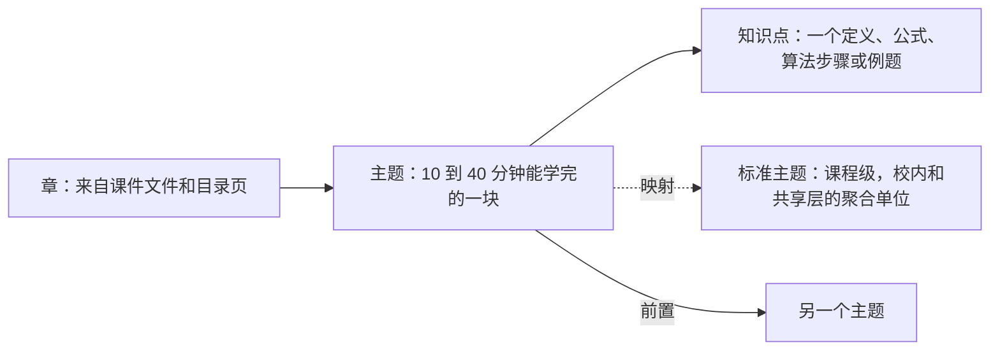
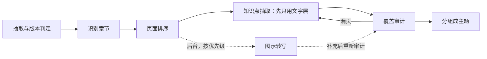
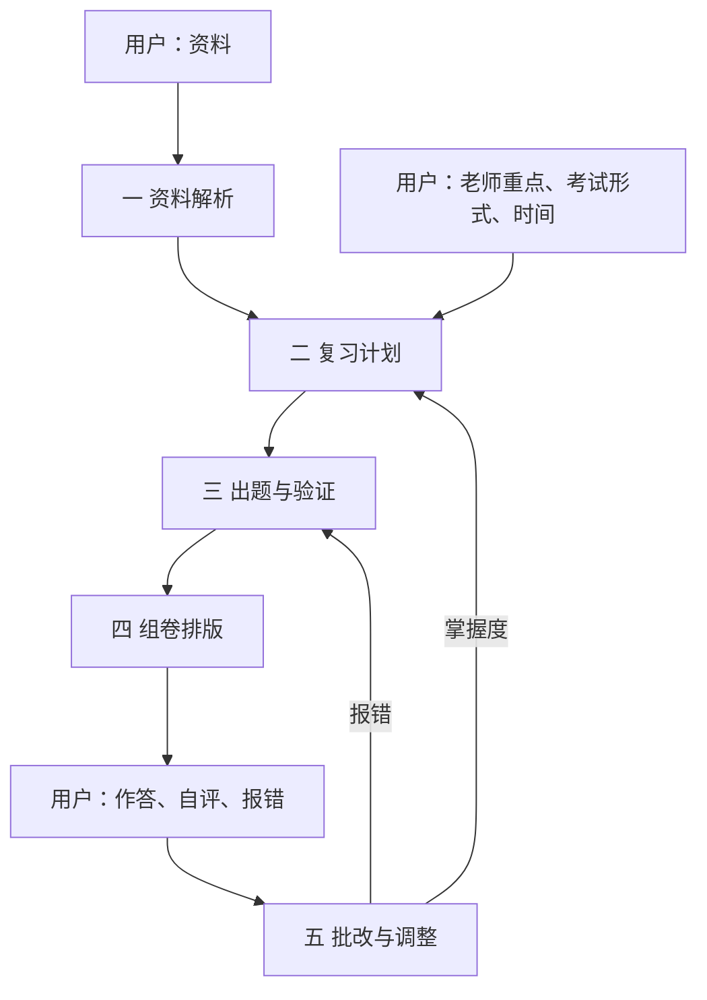
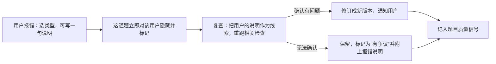

# 设计修订 v2：三级知识库与工作流

状态：设计稿，2026-11-16；2026-11-17 根据两轮实验的结果更新（第 1 轮 E1、E2、E3 见 5.1，第 2 轮 E2b、E3 重跑见 5.2；受影响的是 2.1、3.1、3.3、3.4、第 4 节和第 7 节）；2026-11-23 补入第 3 轮 E3c 的结果（见 5.3），并按讨论新增 2.8 节“个人知识库：来源、证据与关系”；同日补入第 4 轮 E3d 的结果（见 5.4，受影响的是 2.1、3.1 和第 7 节），并按 2.8 修改了原型（见 2.8 末尾）；同日按讨论新增 2.9 节“课程之间的差异：课程画像、扩展点与三级分工调整”，受影响的是 2.2、第 4 节、第 5 节和第 7 节；随后补充 2.9 的“防护不能影响正常使用”，并相应修改 2.6 的关键词扫描。在《项目计划书》和《单一模型 Agent 工作流设计》v1 的基础上修订和补完。v1 中没有被本文改动的部分继续有效。

本文的依据有三类，文中分别标注：

- **实测**：2026-11-16 用现有原型数据做的离线分析（不调用模型），数字见第 1 节。
- **已有结论**：11 月 6 日到 8 日的建库、出题和三轮回归评测。
- **推断**：还没有验证的设计判断。每一项都对应第 5 节的一个实验。
- **实验**：2026-11-17 起用真实模型跑出的结果，见第 5.1 到 5.3 节。

## 0. 改了什么

| 位置 | v1 | v2 | 依据 |
|---|---|---|---|
| 知识点结构 | 平铺的知识点 | 章 → 主题 → 知识点三层，主题是计划和共享的单位 | 实测 |
| 标准知识点 | 只有字段，没有定义 | 落在主题一级，按课程维护，个人主题向它映射 | 推断 |
| 掌握度 | 只有名字 | 三态 + 作答事件记录 | 推断 |
| 资料更新和删除 | 没有设计 | 按内容哈希做依赖链和失效传播 | 推断 |
| 页面分类 | 过滤：只转写含图表的页 | 排序：先转写高产出的页，其余后台补 | 实测 |
| 复习计划 | 知识点按权重和内容量分时间 | 主题按优先级取舍，给出理由，批改后重排 | 实测 |
| 老师重点 | 词语重叠加权 | 映射到主题并分级，分级决定倍数 | 实测 |
| 重要度 | 模型给每个知识点打 1 到 5 分 | 由多种来源的“证据”汇总，每条证据带级别、考法和覆盖范围；没有证据时标明“依据有限” | 实测 |
| 知识点之间的关系 | 只有跨课程链接 | 课程内增加前置、联动、应用、易混等关系 | 推断 |
| 蓝图 | 代码按固定比例定题型 | 新增“考试形式”输入，每个字段记录依据 | 推断 |
| 计算题出题 | 先写解析，再验算 | 先算后写：代码出结果，模型只叙述 | 已有结论 + 推断 |
| 验证组 | 七项检查按风险全跑 | 按题目类别选跑，删去 V2，V3 降为 1 次 | 实测 |
| 裁决 | 任一失败即退回 | 代码能确定的才硬退回，模型判断的只修订一次，之后带提示发布 | 已有结论 |
| 批改 | 一句话 | 出题时生成评分点；主观题默认对照评分点自评 | 推断 |
| 一键报错 | 只有入口 | 分类、复查、修订或标记争议的处理流程 | 推断 |
| 成本与等待 | 原型不限额度 | 预算、缓存、渐进交付、降级表 | 实测 |
| 课程之间的差异 | 没有考虑 | 课程画像加固定流程里的扩展点；扩展只接受声明式数据，代码类扩展只来自团队 | 推断 |
| 三级分工 | 跨校共享标准知识点、统计信号和开放资料 | 校内层增加课程画像；跨校层改为共享扩展模板，不再共享课程内容 | 推断 |

## 1. 新增实测（2026-11-16）

以下分析只读取原型已有的 `data/kb.sqlite` 和 `out/regression/`，没有调用模型。

### 1.1 知识点其实是“页摘要”

| 指标 | 数值 |
|---|---|
| 知识点总数 | 1138（操作系统 410、商务智能 383、高级算法 345） |
| 每份资料的知识点数 | 中位数 28，最多 97 |
| 只引用 1 页的知识点 | 61% |
| 每个知识点对应的页数（按资料算） | 中位数约 1.6 页 |
| 按标题相似度归并后 | 1138 → 1112，只合并了 2.3% |
| 重要度分布 | 5 分 38%，4 分 26%，3 分 31%，2 分及以下 5% |

提示词要求“5 只给核心考点”，结果仍有 64% 的知识点是 4 分或 5 分。重要度基本没有区分度。

### 1.2 现有权重和计划的表现

用操作系统课（归并后 384 个知识点）和示例重点“信号量与 PV 操作，死锁的必要条件和银行家算法，页面替换算法”：

| 指标 | 数值 |
|---|---|
| 被判为“命中重点”的知识点 | 179 个（47%） |
| 重点命中度的最大值 | 0.122（公式里要到 0.33 才算满分，没有一个达到） |
| 最高权重 ÷ 权重中位数 | 1.61 倍（不给重点时 1.23 倍） |
| 权重最高的 10 个知识点合计 | 4.1% |

| 时间预算 | 安排 | 未安排 | 其中只分到 5 分钟 | 未安排里的 5 分知识点 | 未安排里命中重点的 |
|---|---|---|---|---|---|
| 1 天 × 3 小时 | 14 | 370 | 7 | 170 | 165 |
| 3 天 × 4 小时 | 68 | 316 | 48 | 116 | 120 |
| 7 天 × 3 小时 | 122 | 262 | 86 | 68 | 83 |

结论：

- 老师重点几乎不起作用。词语重叠让近一半知识点都“命中”，但每个只加一点权重。
- 计划是一串 5 分钟的碎片。三天的计划里，七成条目只有 5 分钟。
- “未安排”没有解释力。三天计划丢掉了 116 个最高重要度的知识点，用户无法判断哪些是真的可以放弃。

### 1.3 覆盖审计

把“文字层加图示转写不少于 80 字”的页算作有实质内容的页：共 1684 页，其中 145 页（8.6%）没有被任何知识点引用。最严重的是《第四章 设备管理》，146 页里漏了 39 页（27%）。v1 设计的覆盖审计是需要的。

### 1.4 页面分类做不成过滤器

v1 设想由代码挑出需要转写的页，其余不转写。用已有的转写结果反推：

| 规则 | 选中的页 | 召回 | 精确率 |
|---|---|---|---|
| 全部 1896 页（基线，42% 的页转写出了内容） | 100% | 1.00 | 0.42 |
| 文字少于 100 字 | 32% | 0.41 | 0.54 |
| 文字少于 300 字 | 84% | 0.84 | 0.42 |
| 9 份 PDF（882 页）：含非模板的内嵌图片 | 53% | 0.75 | 0.67 |
| 同上：含图片，或文字少于 100 字 | 65% | 0.82 | 0.60 |

- 只看文字量几乎没有用，精确率和随机挑差不多。
- 看内嵌图片有用，但“无图且文字充足”的页里仍有 24% 转写出了内容（多半是矢量图、表格和公式），占全部有内容页的 18%。
- 43 份资料里 30 份是 PPT 或 PPTX，这次没有测到。

结论：分类器省不下太多调用，还会漏掉约两成内容。它适合用来排先后，不适合用来决定转不转写。

### 1.5 验证组各项检查的收益和成本

最后三轮回归评测，每轮 10 道问题题、24 道正常题，合计 30 题次和 72 题次：

| 检查 | 在问题题上判失败 | 在正常题上判失败 | 占验证 token |
|---|---|---|---|
| V1 程序验算 | 6 | 2 | 0（代码） |
| V2 盲解代码 | 3 | 4 | 11.6% |
| V3 独立作答 | 0 | 0 | 25.6% |
| V4 逐步核对 | 3 | 0 | 15.9% |
| V5 推导连贯和完整性 | 3 | 2 | 28.7% |
| V6 选项反驳和选项形式 | 3 | 2 | 18.2% |
| V7 引用核对 | 2 | 1 | 0（代码） |

去掉某些检查后重新统计（“拦下”指至少一项检查判失败，含理由不对的）：

| 保留的检查 | 三轮拦下（每轮 10 道） | 三轮误报（每轮 24 道） |
|---|---|---|
| 全部 | 5、6、6 | 2、3、4 |
| 去掉 V2 | 4、6、5 | 1、3、3 |
| 去掉 V2 和 V3 | 4、6、5 | 1、3、3 |
| 去掉 V1 和 V2 | 3、5、3 | 0、3、2 |

另外，模型输出的 token 里约 93% 是思考过程。

结论：

- V3 三轮没有判过一次失败，却用掉四分之一的验证开销。这与“58 道题答案全对”一致：它防的是答案错，而答案很少错。
- V2 误报比拦截多。
- V4 是唯一没有误报的模型检查。
- V1 触发最多，但回归报告显示其中不少是验算代码没给全中间量造成的，不是题目真的有错。这正是“先算后写”要从结构上解决的问题。

样本只有 34 道题，这些数字只能说明方向，不能当作精确的比率。

## 2. 知识库修订

### 2.1 三层结构：章 → 主题 → 知识点



- **知识点**保持现在的粒度（约 1.6 页一个），用途是出题和标出处。
- **主题**是新增的一层，每个主题约 8 个知识点（大约 13 页、20 到 30 分钟），一门课 40 到 50 个。它是复习计划、掌握度展示和跨用户聚合的单位。最初设想的“一门课 15 到 40 个”偏粗，按实验 E2 调整。
- **章**来自课件文件名和目录页，由代码识别；识别不出时由模型建议、用户确认。

主题怎么来：

1. 抽取完一章的知识点后，模型把它们分组成主题，输出 `{主题名, 一句话说明, 知识点 id 列表, 术语}`。这一步取代 v1 的“知识点归并”（R6）。
2. 代码校验：每个知识点恰好属于一个主题；主题内的知识点页码大致连续，或者共享术语；主题数在合理范围内。不合格就退回。
3. 模型为同一门课的主题建议前置关系，代码检查没有环。前置关系只影响排序和取舍，不影响考试范围。

**实验 E2 之后的三条调整：**

- **由代码给定主题数量。** 不给数量时，模型分出的主题平均只有 3.3 个知识点，同一份课件两次分出的数量可以差近一倍（18 个和 10 个），一致率 83%，没有达到 90% 的判定线。两次的差别主要是粗细：较细那次的主题里，83% 的知识点整体落在较粗那次的某一个主题内。所以数量不交给模型决定：代码按“知识点数 ÷ 8”算出主题数，写进提示词，并校验结果只能多一个或少一个。实验 E2b 的结果：主题大小合适了（平均 6.8 个知识点，三门课各 55 个主题），但一致率仍是 83%。
- **分组结果保存下来，不重复分组。** 对单个用户来说，主题只在导入时分一次，之后一直沿用；资料更新时只调整受影响的主题（见 2.4）。所以“每次分出来都一样”对个人层不是硬要求，它影响的是跨用户对齐。
- **跨用户对齐不依赖分组一致。** 标准主题的映射按术语和名称比较（见 2.2），不要求两位用户把知识点分得一样。

**实验 E2b 之后的结论：主题是“大致的分组”，不能承载需要精确的信息。**

给定数量后一致率没有提高，说明 83% 左右就是这个模型做这件事的稳定程度。进一步看不一致出在哪里：

- 两次分组的分界点有 66% 完全重合。
- 归属不一致的 207 个知识点里，196 个（95%）离某条主题分界不超过两个位置。也就是说，每个主题的核心是稳定的，摇摆的是边界上的知识点。
- 原定的退路“用课件小节标题当主题”查过了，走不通：34 份课件里只有 5 份有成规模的编号标题，其余几乎每页标题都不同。

由此定下三条：

1. **主题只用于展示和排期。** 复习计划按主题列出、按主题估时间，这些用途容许边界上有出入。
2. **需要精确的信息记在知识点上。** 老师重点的级别、掌握度都记在知识点上，主题的数值由它的知识点汇总得到。这样主题怎么分，不改变“哪些知识点被强调、哪些不考”。
3. **判定标准相应改变。** 原来的标准是“两次分组的一致率 90% 以上”，两轮都没有达到。新的标准是下游结果的一致率：同一句重点，在两次不同的分组下落到的知识点和级别是否相同，由实验 E3c 验证。这是更换了标准，不是达到了原标准；如果 E3c 也不达标，主题这一层就需要重新考虑。

   **E3c 的结果（见 5.3）：** 下游一致率 65%，也没有达标。但拆开看，不一致几乎都不是分组造成的：在候选知识点完全相同的情况下，模型这次选 2 个、下次选 5 个。所以 E3c 没能回答“分组差异会不会传到下游”，它被另一种更大的波动盖住了。在下结论之前先做 E3d：用多数表决压住选择的波动，并测出同一分组下的噪声底线。判定线不变。

   **E3d 的结果（见 5.4）：** 仍未达标。多数表决后，同一分组两遍的一致率 87%，不同分组之间 71% 和 72%。拆开看，不同分组之间多出来的分歧全部来自一句话：“管程今年不作要求”在第 1 次分组下漏掉了 9 个霍尔管程的知识点。原因不在分组本身，而在第一步的提示词要求“宁可少，不要多”，模型只选了标题叫“管程”的主题，没选同样写着“霍尔管程”的另一个主题。去掉这一句，不同分组之间是 83% 到 84%，和同一分组下的 85% 相当。**结论：分组差异对下游的影响只经过第一步的召回，修第一步即可，主题这一层保留。**

### 2.2 标准主题：三层之间的连接点

v1 的 `canonical_topic_id` 是校内层和共享层聚合信号的键，但没有说它从哪来。v2 的定义：

- **粒度：** 标准主题与个人主题同级，不到知识点一级。知识点一级在不同人的资料里差别太大，对不齐。
- **归属：** 按“课程”维护（学校 + 课程代码），同一门课不同学期、不同教师共用一套；跨校课程通过已有的 `course_links` 关联。
- **来源：** 第一位用户的主题成为候选标准主题。之后每位用户的主题与已有标准主题比较术语和名称，模型给出映射建议，代码要求至少共享一个术语才接受。对不上的留在个人层，同一个新主题出现在 3 位用户的资料里才升为标准主题。
- **不强求：** 映射不上不影响个人层的任何功能，只是这个主题拿不到校内和共享信号。

本期校内层和共享层只有模拟数据，所以这套机制本期只需要做到“数据结构支持、演示数据能跑通”。

**2026-11-23 调整（见 2.9）：** 跨校层不再共享课程内容，标准主题只在校内层使用，本期只出现在演示数据里。

### 2.3 掌握度

| 状态 | 含义 | 进入条件 |
|---|---|---|
| 未学 | 没有任何记录 | 初始状态 |
| 不稳 | 学过但还会错 | 做错或部分做对一次；或用户标记“还不熟” |
| 掌握 | 可以缩短复习时间 | 在两道不同的题上做对；或做对一次且用户标记“已掌握” |

- 状态记在知识点上，主题的掌握度由其下知识点汇总（例如“7 个里掌握 4 个”）。
- 保存的是**事件**（哪道题、对错、自评还是自动判分、时间），状态由规则从事件算出。规则以后可以改，事件不用动。
- 一个考试周期只有几天到几周，本期不做遗忘衰减。
- 做对之后又做错，回到“不稳”。

### 2.4 资料更新和删除时的失效传播

原型的 `points` 表已经记录了每份资料的内容哈希，v2 把它扩展成依赖链：

```
资料版本（内容哈希，每页一个页哈希）
  └─ 知识点（引用哪些页）
       ├─ 主题
       └─ 题目（每个步骤引用的页和原文）
            └─ 作答事件
```

**任务固定输入版本。** 建库或出题任务入队时，记录它使用的资料版本和处理配置。执行和恢复都读取该版本，避免同一份结果混用新旧课件。各阶段根据输入内容哈希和该阶段实际使用的配置复用结果，例如模型和提示词版本。只改出题提示词时，已有的转写和知识点仍可沿用，新出题任务使用新配置。参考 [AgentOS 的版本快照和缓存设计](https://github.com/Rosolio/oslab2026-agentos/blob/c19c6eb26e83e9b2d60a26953c6c0d1fd28e1c46/README.md#核心机制)。

**课件出了新版本（同一版本组里的最终版换了）：**

1. 逐页比较页哈希，把页分成“没变”“改了”“新增”“删除”。
2. 只引用“没变”的页的知识点直接沿用，页码按新版本重新对应。
3. 涉及“改了”或“新增”的页，只对这些页重新抽取知识点。
4. 题目先用引用核对（V7，代码，不花模型）在新版本上重查一遍：原文还在就继续有效；找不到就标为“待复查”，不再出现在新试卷里，已做过的作答记录保留。
5. 主题的归属尽量保持不变，新知识点由模型归入已有主题或新建主题。

**用户删除资料：** 级联删除它的页、知识点和题目。如果它贡献过校内或共享信号，按信号记录的来源资料 ID 重算；贡献者不足 3 人时撤回该信号。这一条 v1 已有，这里只是把它接到同一条依赖链上。

### 2.5 导入管线的调整



- **页面排序取代页面分类。** 所有页最终都会转写，但先处理含内嵌图片和文字很少的页。预算不够时从队尾截断，并在界面上标出“这些页的图示还没有解析”。
- **先用文字层出第一版知识点和计划。** 用户不必等全部转写完成，转写结果到达后增量更新。
- **覆盖审计保留。** 实测漏页 8.6%，个别课件 27%。
- **模型不支持图片时：** 配置模型时检测一次。不支持就跳过转写，含图片的页标为“图示未解析”，这些页不作为计算题的唯一依据。

### 2.6 共享文本是不可信输入

校内层和共享层的授权文本会进入其他用户的模型上下文。权限判定只管“谁能读”，管不了“内容里写了什么”。措施：

- 资料内容一律放在数据标签里，系统提示词声明标签内的指令不执行（原型已有）。
- 模型的输出只能是通过 Schema 校验的结构化数据；引用必须在原文中逐字找到；代码只在沙箱里执行。这三条让注入内容很难变成实际后果。
- 检索 agent 只有三个只读工具，没有写入、联网和执行能力。
- 文本进入校内或共享层之前，审核环节增加一项：扫描“忽略以上指令”“你现在是”这类面向模型的句式。命中的只做标记，由人工决定是否放进共享层；不阻止上传者本人使用，也不改动资料内容。讲提示词注入的课件会正常命中，不能因此被拦（见 2.9）。
- 校内和共享文本只能作为证据页出现，不能进入系统提示词的位置。

### 2.7 校内层增加“题目质量”信号

v1 的校内信号只有考点频率和题型。v2 增加一类：同一标准主题下，被多位用户确认无误的题目数、被报错的次数和类型。它的价值比考点频率更直接，因为报错是模型自己发现不了的外部反馈。

是否共享题目本身还没有定：题目引用了课件原文，应当按“文本”的规则处理，需要权利依据。本期只共享计数。

### 2.8 个人知识库：来源、证据与关系

2026-11-23 定下的方向：个人知识库不只是课件，还包括笔记、作业、错题等。要维护它，在知识点之间建立联系，并判断重要度，复习计划才能排好。

#### 来源

| 来源 | 例子 | 提供什么 |
|---|---|---|
| 课件 | 老师的 PPT、PDF | 内容和知识点 |
| 笔记 | 课件备注栏和页面上的批注、单独的笔记 | 判断类笔记是重要度和考法的证据；讲解类笔记补充内容 |
| 老师的重点材料 | 复习题讲义、口头总结 | 重要度和考法；复习题本身就是新内容 |
| 作业 | 做过的作业 | 考法；作业考过的内容更重要 |
| 错题 | 批改后做错的题 | 掌握度、易混点 |
| 往年卷 | 本校往年卷 | 题型、分值、考点频率 |
| 用户直接标记 | 在主题列表上勾选“老师反复讲过” | 重要度 |

这些都是用户自己的资料或自己的判断，都在个人层。

#### 原型检查发现的问题

用 `workflow/evidence_check.py` 离线检查了现有知识库，不调用模型，报告在原型的 `out/evidence-check.md`。

**备注栏里混着三种内容，原型把它们当成同一种。** 导入时备注栏统一标成“[讲稿]”附在页面文字后面。实际上：

| 类型 | 例子 | 数量 |
|---|---|---|
| 判断：对重要度和考法的评价 | “一道大题”“不会单独考察”“不需要记忆但要理解”“不能写错”“重点” | 商务智能 2 份课件上 11 条，是用户上课时自己记的 |
| 讲解：对内容的补充说明 | 强连通分量的证明思路、大 O 定义的说明 | 高级算法 7 份课件上约 20 条，多半是课件原作者留的 |
| 其他：模板文字 | “欢迎辞” | 少量 |

判断类混进正文之后，考法信息就丢了。例如“度量值”一页的笔记是“不会单独考察”，意思是会和别的知识点一起考；模型给这个知识点打了 3 分，低于这份课件的平均 3.74 分，等于把它读成了“不太重要”。另外两条判断落不到任何知识点：“一道大题”写在 OLAP 课件的标题页，第 23 页的“不会单独考察”所在页没有被抽出知识点。

版本判定没有问题：两份带批注的课件，被选为最终版的正是带批注的 `.pptx`。

**有证据的知识点很少。**

| 课程 | 知识点 | 至少有一种证据的知识点 | 证据来自 |
|---|---|---|---|
| 商务智能 | 383 | 11（3%） | 判断类笔记 |
| 操作系统 | 399 | 2（1%） | 作业 |
| 高级算法 | 303 + 复习题 21 | 21（6%） | 复习题讲义 |

作业一列用的是原型的词语重叠规则，几乎匹配不上，说明作业和课件知识点的对应也需要模型来做，做法同重点映射。即使算上作业，绝大多数知识点也没有任何证据。所以“没有重点”是常态，计划必须在只有弱依据时也能排，并且说明依据有限。

#### 证据

重要度不再是模型给每个知识点打的一个分数，而是由“证据”汇总出来。每条证据记录：

| 字段 | 说明 |
|---|---|
| 知识点 | 证据落在哪个知识点上，可以是多个 |
| 来源 | 笔记、老师重点材料、作业、错题、往年卷、用户标记、模型判断 |
| 原文 | 证据的原话，例如“不会单独考察” |
| 级别 | 不考、提及、强调；可以为空，只带考法 |
| 考法 | 见下 |
| 覆盖范围 | 这个来源涉及哪些课件或章节 |

规则：

1. **证据只在覆盖范围内起作用。** 课件批注的范围是它所在的那份课件；复习题讲义的范围由用户确认（例如“只讲了动态规划”）；口头总结要问用户是不是覆盖全课。范围外没有提到的内容是“未知”，不降权。
2. **来源有先后。** 用户确认 > 老师的材料 > 学生笔记 > 作业和往年卷 > 模型判断。同一知识点的证据冲突时，先后在前的优先；“不考”与“强调”冲突时请用户确认。
3. **落点。** 页面上的证据落到引用这一页的知识点；页面上没有知识点时（标题页、过渡页），标题页上的判断算整份课件的证据，其他页落到前后最近的知识点，并标明是推断。
4. **没有任何证据时**，用作业、课件篇幅（一个内容讲了几页）、模型的重要度打分作为弱依据。计划上标出“依据有限”，并提示用户可以在主题列表上直接勾选。
5. **全部保存为证据，重要度由规则算出。** 新增一份笔记或一道错题，只是多了几条证据，重新计算即可；删除资料就删掉它的证据。做法与掌握度（2.3）相同。

#### 考法

笔记里的“不需要记忆但要理解”“不会单独考察”说的不是“重不重要”，而是“怎么考”。这类信息对出题比一个权重数字更有用。

| 考法 | 含义 | 来自笔记的例子 | 出题 | 复习计划 |
|---|---|---|---|---|
| 记忆 | 定义、要点要能准确写出 | “不能写错” | 填空、默写、判断 | 安排复述 |
| 理解 | 能解释、比较、判断，不要求背 | “不需要记忆但要理解”“不用背” | 不出默写；出解释、比较、判断对错 | 安排看例子和对比 |
| 计算与模拟 | 按算法算出结果或过程 | 复习题、作业 | 计算题，先算后写 | 安排练习 |
| 设计 | 写算法、递推式、模型 | 复习题 | 设计题 | 安排练习 |
| 证明 | 证明正确性、最优性、上下界 | 复习题 | 证明题 | 安排练习 |
| 联动 | 不单独出题，和别的知识点一起考 | “不会单独考察” | 不单独出题，出在综合题里 | 和联动的知识点排在一起 |
| 大题 | 分值大的综合题 | “一道大题” | 蓝图里给它留一道大题 | 留出整块时间 |

一个知识点可以有多种考法。考法和级别是两件事：“不会单独考察”的知识点级别不降，只是单独出题的数量降低、在综合题里出现。考法流向两处：出题蓝图（3.2）按考法选题型；复习计划按考法安排复述还是练习。

#### 知识点之间的关系

| 关系 | 例子 | 从哪来 | 用来做什么 |
|---|---|---|---|
| 前置 | 系统安全状态 → 银行家算法 | 课件顺序、模型建议 | 排期顺序；取舍时把前置一起选上 |
| 联动 | 度量值、维 → 多维数据模型 | “不会单独考察”的笔记、复习题、往年卷 | 出综合题；计划里排在一起 |
| 应用 | 钢条切割（复习题）用到动态规划的基本思想 | 复习题、作业 | 复习题的前置内容；出变式题 |
| 同一内容 | 课件里的 0-1 背包和作业里的 0-1 背包 | 归并 | 合并它们的证据 |
| 易混 | MOLAP 与 ROLAP | 课件的对比页、错题 | 出对比题；计划里并排 |

跨课程的链接（Java 与 C++ 这类）沿用《项目计划书》第 3 节的规则。

关系的可信度跟着来源走。笔记和老师材料给出的关系直接使用；模型建议的关系先作为候选，只用于排期顺序，不影响权重和考试范围，用户确认后才用于出题。“不会单独考察”只说明有联动，没说和谁联动，联动的对象由模型在同一份课件里建议、用户可以改。

#### 原型的改动（2026-11-23）

| 设计 | 原型里的做法 | 文件 |
|---|---|---|
| 备注栏单独保存并分类 | 导入和上传时把备注栏另存到 `notes` 表，按规则分成判断、讲解、其他。页面正文不变，仍然包含备注栏 | `kb/evidence_db.py`、`kb/ingest.py`、`kb/upload.py` |
| 判断类笔记由模型归类 | `--model` 时按课件一次调用，给出类型、级别和考法；规则的分类保留在报告里对照 | `workflow/evidence.py` |
| 证据表和关系表 | 新增 `evidence`、`kp_links`、`material_roles` 三张表；证据只属于本人，读取时先判定资料权限 | `kb/evidence_db.py`、`kb/store.py` |
| 重要度和考法由证据算出 | `KnowledgeBase.derived()` 按本节的五条规则算出级别、考法和依据 | `kb/evidence_db.py` |
| 复习题讲义 | 按“Problem / Solution”识别；用户在 `data/material_roles.json` 里确认后，每道例题记为强调，未确认时只是候选。`--model` 时再问“用到了课件里哪些方法”，建立“应用”关系 | `workflow/evidence.py` |
| 作业 | 不加 `--model` 时沿用词语重叠规则；加 `--model` 时由模型对应到课件知识点，并给出考法 | 同上 |
| 联动 | “不会单独考察”的笔记，由模型在同一份课件里建议联动的知识点 | 同上 |

几处有意的取舍：

- **页面正文暂不去掉备注栏。** 去掉会改变内容哈希，已有的 1138 个知识点和题目引用会全部重抽。判断类笔记已另存为证据，讲解类本来就在正文里。等下次整体重建知识库时再分开。
- **“不会单独考察”“不需要记忆但要理解”只给考法，不给级别。** 规则版最初把它们记成“提及”，等于降级，与本节“考法和级别是两件事”矛盾，已改。
- **标题页的“一道大题”：级别落到整份课件，考法单独记为“整份资料的考法”。** 它说的是这一章会出一道大题，不是每个知识点都是大题。
- **证据和关系先写在知识库副本里。** `workflow/evidence.py` 只写 `--db` 指向的副本，`data/kb.sqlite` 和复习计划都还没有用到它们。计划改为按证据排（3.1）是下一步。

规则版的结果（`out/evidence-rules/report.md`，不调用模型）：

| 课程 | 知识点 | 有证据 | 作业考过 | 范围内未提及 | 依据有限 |
|---|---|---|---|---|---|
| 商务智能 | 383 | 33 | 0 | 33 | 317 |
| 操作系统 | 410 | 0 | 2 | 0 | 408 |
| 高级算法 | 345 | 21 | 0 | 0 | 324 |

商务智能的 33 个里有 31 个来自 OLAP 标题页的“一道大题”。模型版（备注分类、复习题和作业的对应、联动建议）由第 5 轮代跑。

还没有做的：课程内的前置和易混关系；用户直接标记的界面；用往年卷和错题做证据（现在没有这两种资料）。

### 2.9 课程之间的差异：课程画像、扩展点与三级分工调整

2026-11-23 讨论定下的方向。起因是：不同课程的资料、知识类型和题型差别很大，设计阶段不可能全部覆盖。现有的三门课已经是三种情况：

| 课程 | 重点的形式 | 主要考法（已知部分） |
|---|---|---|
| 操作系统 | 没有提供重点 | 计算与模拟（调度、银行家算法、页面替换、磁盘调度） |
| 商务智能 | 2 份课件上的用户批注 | 理解、联动、大题（OLAP） |
| 高级算法 | 复习题讲义（动态规划和少量贪心） | 设计、证明、计算 |

再加一门法学、英语或实验课，必然还有现在没想到的形式。所以不再追求在设计阶段穷举，而是留出扩展的位置。

#### 不采用“agent 运行时给自己写插件”

DeepSeek Harness 这类框架把模型、工具、循环、沙箱都做成插件，agent 甚至可以自己写插件、挂到正在运行的会话里。这套做法的前提是“用户就是开发者，在自己的机器上信任自己的 agent”。本项目不满足：

- 最终用户是学生，不是插件作者。
- 只有一个模型，能力可能一般。验证组实测同一模型的自检只拦下约 43% 的问题；让 agent 写检查器、再由同一模型判断它对不对，是循环论证。
- 资料是不可信输入（2.6）。如果 agent 能根据资料内容扩展自己，资料里的注入就有了实际后果。
- “权限由代码判定”“能用程序判断的不交给模型”这两条原则会被绕过。

做法改为：**流程固定，在流程里留出扩展点；扩展点只接受声明式的数据，代码类扩展只能来自团队。**

#### 课程画像

每门课一份课程画像，描述这门课在各扩展点上的取值。它是声明式数据（JSON 加提示词片段），没有可执行代码。

| 字段 | 内容 | 例子 |
|---|---|---|
| 资料角色 | 这门课有哪些资料类型，各自怎么识别、覆盖什么范围 | 高级算法：复习题讲义，按“Problem / Solution”识别，范围“动态规划和少量贪心” |
| 重点形式 | 老师的重点以什么形式出现 | 商务智能：课件批注，范围为所在课件 |
| 知识类型 | 启用哪些知识点类别 | 操作系统：定义、算法、计算 |
| 考法词表 | 补充的说法到考法的对应 | “开卷，不用背”→ 理解 |
| 考试形式 | 题型、题量、分值、时长、是否开卷，各带依据 | 依据为“老师”“往年卷”“默认（猜的）” |
| 启用题型 | 这门课出哪些题型 | 高级算法：设计算法、写递推式、分析复杂度、证明 |
| 验证器 | 这门课可用的程序检查 | 先算后写的沙箱执行 |

画像的来源：

1. **agent 和用户对话起草。** 例如问“考试有哪些题型”“老师一般怎么给重点”，也可以从已导入的资料里推断。起草结果按 Schema 校验，在界面上逐项给用户确认后才生效。
2. **从校内层采用同一门课的画像**（见下文三级分工），采用时同样要用户确认。
3. **没有任何依据时用默认模板**，并在计划和试卷上标出“按默认设置，未必与真实考试一致”。

画像里的每个字段都记录来源（用户确认、老师材料、资料推断、模型建议、默认），与 2.8 的证据规则一致。

#### 扩展点

| 扩展点 | 扩展的内容 | 必须提供 | 形式 |
|---|---|---|---|
| 资料类型 | 新的资料角色，如实验指导书、往年卷、案例集 | 识别规则（文件名、关键词、版式）；用哪个内置解析器；产出知识点、证据还是考法；默认覆盖范围；是否需要用户确认 | 声明式 |
| 知识类型 | 新的知识点类别，如法条、单词语法、化学方程式、代码片段 | 类别说明；抽取提示词片段；是否可计算 | 声明式 |
| 考法词表 | 新的说法到考法、级别的对应 | 短语、考法、级别（可空） | 声明式 |
| 题型 | 新题型，如程序填空、翻译、案例分析 | 题目结构（只能用固定的内容块）；出题提示词；必须运行的检查（从已有检查中选）；批改方式；评分点要求 | 声明式 |
| 验证器 | 新的程序检查，如运行代码测试、方程式配平、执行 SQL | 代码和测试 | 代码，只能来自团队 |
| 内容块 | 新的渲染方式，如电路图、化学结构式 | 渲染代码 | 代码，只能来自团队 |
| 解析器 | 新的文件格式 | 解析代码和测试 | 代码，只能来自团队 |

不开放扩展的部分：权限判定、证据的先后规则（2.8）、裁决三档（3.4）、计划的取舍和排期算法（3.1）、核心数据结构。

两条约束：

- **新题型必须声明它跑哪些检查。** 一项都没有的题型也能用，但题目一律标为“未经检查”。这样扩展不会破坏“不承诺题目一定正确”的底线。
- **新题型只能用已有的内容块渲染**（文字、表格、代码、公式、图片）。需要新的内容块，就是代码扩展，由团队实现。鸿蒙端的 ArkWeb 渲染页因此不需要加载任何外来脚本。

#### 资料中的注入：多层防护

模型通常能分清“资料里写的”和“用户说的”。原型已经把资料放在数据标签里（2.6），这是第一层，但它是概率性的，不能当作安全边界。何况本项目的条件比通用 agent 工具更差：模型能力一般，批量处理资料时也没有人盯着。所以再加三层由代码保证的防护：

1. **处理资料时没有危险的工具。** 抽取、映射、出题这些调用只能输出通过 Schema 校验的结构化数据，手里没有安装扩展、修改画像或配置的工具。即使模型被资料里的话骗了，也做不出实际的事。
2. **画像和扩展只能经用户确认后变更。** agent 只能提出建议，界面显示变更前后的差别，由用户点确认。这和 Codex、Claude Code 在执行危险操作前要用户批准是同一个思路：最后一道关是代码，不是模型。
3. **代码类扩展不经过对话产生。** 验证器、内容块、解析器只能来自团队的仓库。

还有一类问题区分“指令和资料”解决不了：内容本身是错的或恶意的，但看起来完全是正常资料，比如一份共享笔记写着“老师说第三章不考”。模型正确地把它当资料读，照样会被带偏。这类问题靠 2.8 的来源先后、覆盖范围和用户确认处理，不属于注入防护。

#### 防护不能影响正常使用

**防护靠限制能力，不靠过滤内容。** 课件、作业和复习题里到处是“请证明……”“编写程序实现……”“注意：本题不考……”这类祈使句，讲 AI 安全的课件还会整页讨论提示词注入。如果按“像不像指令”去拦截或删改资料，会大量误伤正常内容。所以资料一律照常读取和抽取，不做内容过滤；防护只放在“模型能做什么”上。

各层防护对用户的影响：

| 防护 | 用户能感觉到吗 | 说明 |
|---|---|---|
| 资料放在数据标签里 | 感觉不到 | 只是提示词的写法 |
| 处理资料时没有危险工具 | 感觉不到 | 抽取、出题本来就不需要装扩展、改配置 |
| 输出必须符合 Schema | 感觉不到 | 为了题目正确性本来就要有 |
| 代码类扩展只来自团队 | 感觉不到 | 用户本来就不写代码 |
| 画像和扩展要用户确认 | 能感觉到 | 唯一可见的一层，频率很低 |
| 共享文本的关键词扫描（2.6） | 个人使用感觉不到 | 只在资料进入校内层时运行，命中只做标记 |

唯一可见的是“确认”，守住三条：

1. **只对会长期改变行为的东西要确认。** 也就是课程画像和扩展。每门课建好时确认一次画像，之后偶尔修改，一学期大约几次。
2. **确认要轻。** 默认值预先填好，一屏看完，可以“全部接受”；不打断正在进行的复习或做题。
3. **产品上的询问和安全确认分开。** 边界知识点“可能也包括”、复习题讲义的覆盖范围这类询问，是为了让计划更准。用户不理会就按默认值走，不做成必须点掉的弹窗。

#### 三级分工的调整

讨论中确认：跨校共享对“这门课怎么考”帮助很小，而且它要提供的通用知识结构，模型本身基本能给出；授权、审核、防冒充、防刷数据的成本却很高。另一方面，E9 显示个人资料里只有 1% 到 6% 的知识点有证据，外部信号在这块空白里最有用，但有用的是同课程、同教师的校内信号，不是跨校信号。

| 层 | 原设计共享的内容 | 调整后 |
|---|---|---|
| 个人 | 资料、证据、掌握度、跨课程链接 | 不变，是核心 |
| 校内 | 考点频率、题型、授权文本 | 增加**课程画像**，作为这一层的主要价值；统计信号保留；授权文本的规则不变，仍然最严 |
| 跨校 | 标准知识点、统计信号、开放许可资料 | 不再共享课程内容，改为共享**扩展模板**：题型定义、资料类型识别规则、考法词表 |

调整后：

- **跨校层不再涉及课程内容。** 版权、授权和信号污染的问题基本绕开；它服务的是“适应更多课程”，例如一所学校写好的“案例分析”题型，别的学校的法学课也能用。
- **共享出去的都是声明式数据。** 校内的课程画像和跨校的扩展模板都按 Schema 校验，用户采用时确认，不含可执行代码。它们仍是不可信输入：提示词片段只能放在数据位置，不能进入系统提示词。
- **2.2 的标准主题降为可选。** 它原本是跨校聚合的键，本期只在校内层的演示数据里使用。
- **原有判定规则继续有效：** 每加一层信号，都用真卷测覆盖率，没有明显提升就不急着上线。

#### 本期做到哪里

1. 把现有的内置能力改写成扩展的形式：三种重点形式（口头总结、页面批注、复习题讲义），现有题型（计算、证明、概念单选、简答）。也就是团队自己先用一遍这套接口。
2. 给三门课各写一份课程画像。验收标准：主流程里不再出现针对某门课的分支（实验 E11）。
3. 在纸面上用一门差别很大的课（大学英语或法学）走一遍，列出缺少的扩展点。
4. 校内层的课程画像共享用模拟数据演示；跨校模板库和“agent 起草代码扩展”写进报告作为后续设计，本期不做。

## 3. 工作流修订

修订后的五个阶段：



### 3.1 复习计划

这是与同类产品的差异点，v1 写得最少。

**输入：** 主题列表（含知识点、页数、前置关系）、老师重点、考试日期、每天可用时间、掌握度。

**第一步，重点分级（模型映射，代码校验）。** 模型把老师重点的每个片段映射到主题，并判断强调程度。代码校验片段确实出现在原文里、主题确实存在。

| 级别 | 判断依据 | 权重倍数（暂定） |
|---|---|---|
| 明确不考 | “这部分不考”“了解即可” | 0 |
| 未提及 | 重点里没有出现 | 1 |
| 提及 | 出现在重点里 | 2.5 |
| 强调 | “一定会考”“要会算”“大题” | 4 |

映射不到任何主题的片段要告诉用户“老师提到的 X 在课件里没找到”。老师完全没给重点时，所有主题都是“未提及”，计划退化为按内容量和作业情况排。

同一个主题被多个片段映射到、级别不一致时，由代码合并：有“明确不考”且没有其他级别时取“明确不考”；否则取最高的级别；“明确不考”与“强调”同时出现时不自动决定，请用户确认。

实验 E3 的结果支持这一步：11 句口语化的示例重点，映射和分级全部正确，包括三句“不考”和一句课件里没有的内容；词语重叠只能做到 9 句，而且不能分级。这是在示例重点上的结果，还需要用老师真实划的重点再测。

**级别要落到知识点，不能停在主题。** 用 E2b 的较大主题重跑 E3，按原来的评分仍是 11/11，但逐条看结果发现了评分没有覆盖的问题：级别会波及同一主题里老师没提到的内容。

| 老师的话 | 映射到的主题 | 被一起标上级别的内容 |
|---|---|---|
| RAID 各级别了解一下就行，不会考 | RAID 与磁盘高速缓存（不考） | 磁盘高速缓存和两种缓存替换策略，共 3 个知识点 |
| 计算机发展史那些不考 | 计算机硬件基础与系统组成（不考） | 冯·诺依曼结构、总线、CPU、存储器层次、I/O 控制方式等，8 个知识点里只有 1 个是发展史 |

“不考”的倍数是 0，波及会让该学的内容从计划里消失，比漏掉一个重点更严重。所以第一步改为两小步：

1. 模型把重点映射到主题（缩小范围）。
2. 模型在这些主题的知识点里选出老师确实指的那些，并给出级别；代码校验编号有效。级别记在知识点上。

主题的重点倍数取它的知识点倍数的平均值；被标为“不考”的知识点从主题的学习时间里扣除；计划里在主题下标出“老师强调的是这几个”。这一步由实验 E3c 验证，评测文件里为四句重点加了“不应被波及”的关键词。

E3c 的结果：两步做法解决了波及（0 个，只映射到主题时是 9 个），被标为“不考”的 25 个知识点在两次运行里完全相同。没有解决的是“选多宽”：老师说“银行家算法一定会考大题”，一次只选了 2 个知识点，另一次选了 5 个。窄的一次是错的一方，例如“磁盘移臂调度看一下”有一次只选了“磁盘驱动调度”，漏掉了全部 8 个移臂调度算法。处理办法是第二步独立选 3 次、取过半数，由 E3d 验证。

E3d 的结果和由此定下的三条（细节见 5.4）：

1. **第一步改为“宁可多”。** 两步做法里，精确由第二步负责，第一步的任务是不漏。原提示词里的“宁可少，不要多”是 E3 只有一步时为防波及写的，沿用到两步做法里就成了漏选的来源（“管程不作要求”漏掉了霍尔管程的 9 个知识点）。改为：内容相关的主题都列上，只有明确无关的才不列；另外由代码补上标题里含有片段核心词的主题。这是设计方沿用旧提示词的疏忽。
2. **多数表决保留。** 单次选择两两之间的一致率是 78%，表决后同一分组下是 87%，有效但不到 90%。三票全中的知识点并不比过半数的更稳定，再加票意义不大。
3. **边界上的知识点不再追求一致，改为交给用户。** 剩下的分歧集中在三句话的少数知识点上：“低级调度”算不算“进程调度”，“磁盘驱动调度”这个总括概念算不算“移臂调度”，“SPOOLing 系统概念”算不算“SPOOLing 的原理”。这些两种选法都说得通，人来判断也会摇摆。它们的分歧都是“提及或强调”与“未提及”之间，没有一处是错标“不考”。计划里在主题下列出“老师强调的是这几个”，用户可以增删；票数不全的知识点标为“可能也包括”。

**重点有两种形式，上面的办法只处理了一种。** 2026-11-17 确认了第一份真实的老师重点：高级算法的复习课讲义 `DynamicProgrammingReview.pdf`，17 道例题及解答。它和设计时设想的“口头划重点”很不一样：

| | 口头重点 | 复习题讲义 |
|---|---|---|
| 样子 | “银行家算法一定考大题”“RAID 不考” | 一组例题和解答 |
| 说的是什么 | 指向课件里已有的内容 | 本身就是要学的内容 |
| 强调程度 | 靠措辞判断 | 没有措辞，出现在讲义里就是重点 |
| 与课件的关系 | 都在课件范围内 | 大部分例题课件里没有 |

最后一行是关键。对照知识库：这 17 道例题里，最长公共子串、最长回文子序列、序列比对、钢条切割、子集和、三划分等十多道，在平时的课件里找不到对应的知识点；课件的动态规划部分只讲了基本思想和矩阵连乘。能对上的只有 0-1 背包、硬币找零的贪心解法、DAG 上的最长路径（对应关键路径）这几处。

由此补充四条：

1. **导入时区分资料类型。** 复习课讲义现在被当成普通课件导入（类型是“其他”），它的 21 个知识点和平时课件的知识点混在一起。导入时应当识别“复习课”“Problem / Solution”这类特征，并请用户确认它是不是老师的重点材料，确认后类型记为老师重点。
2. **考试范围 = 课件 + 老师的重点材料。** 原来把“超出课件”一律当作可能超纲，这对复习题讲义不成立：讲义里的内容即使课件没有，也在范围内，而且是最该学的。
3. **复习题讲义里的每道例题是一个知识点，级别直接记为强调。** 不需要映射才能得到级别。映射的作用变成另一件事：找出这道例题用到了课件里的哪些方法（例如动态规划的基本思想、最优子结构），把这些作为它的前置内容排进计划。
4. **复习题是模拟卷最好的出题依据。** 它直接给出了题型（设计算法、写递推式、分析复杂度、证明贪心最优）和难度。出题时优先出这些例题的变式，而且这类题正适合先算后写：递推表由代码算出。蓝图的“考试形式”可以从讲义的题型里推出一部分，依据记为“老师的复习材料”。

这份讲义只覆盖动态规划和少量贪心。它不能说明其他章节不考，所以没出现在讲义里的主题仍是“未提及”，不是“不考”。

**以上各种形式，最后都转成 2.8 节的“证据”。** 口头总结用两步映射转成证据（E3c、E3d 验证的就是这一步）；课件批注按页直接落点；复习题讲义里的例题作为新知识点导入，本身就是强调级的证据。计划只读证据算出的级别和考法，不关心证据从哪种形式来。

**第二步，主题权重（代码）。**

```
权重 = 基础分 × 重点倍数 × 掌握度系数 + 作业加分 + 校内信号调整 + 共享信号调整
```

- 基础分：主题下知识点重要度的平均值，归一化到 0.5 到 1。重要度区分度很低，所以它只起次要作用。
- 掌握度系数：未学 1，不稳 1.2，已掌握 0.3。
- 作业加分：作业考过的主题加 0.15（沿用原型）。
- 校内和共享信号：上限仍是 0.2 和 0.1，相对于归一化后的权重。

**第三步，估计时间（代码）。** 每个主题的学习时间 = 页数 × 每页分钟数 + 计算类知识点数 × 练习分钟数，下限 15 分钟。系数先取 2 分钟每页和 10 分钟每个计算类知识点，之后按用户实际用时校准。

**第四步，取舍（代码）。**

1. 预留 20% 的时间做模拟卷和看错题。
2. 按“权重 ÷ 时间”从高到低选主题，直到用完时间。
3. 选中的主题如果有未掌握的前置主题，把前置主题也选进来；放不下时给前置主题一个缩短版（只看核心知识点）。
4. 输出三个清单，每一项都带理由：

| 清单 | 含义 | 理由示例 |
|---|---|---|
| 必学 | 在时间预算内 | “老师强调”“作业考过”“是银行家算法的前置” |
| 有时间再学 | 按优先级排在预算之外的前一段 | “老师未提及，约需 25 分钟” |
| 本次放弃 | 其余 | “老师说不考”“未提及且耗时长” |

5. 时间极少（例如只剩一天）时切换模式：只列强调级主题的核心知识点，加一套短的模拟题。

**第五步，排期（代码）。** 前置主题在前，同一章尽量连续，计算类主题后面紧跟练习，最后一天留给错题和“不稳”的主题。

**第六步，重排。** 每次批改后更新掌握度，剩余天数的计划重算。用户可以把某个主题固定为“必学”或“放弃”，固定的项不被重排改动。

### 3.2 蓝图：新增“考试形式”输入

v1 的蓝图由代码按固定比例决定题型（原型里是约 40% 计算题）。真实考试的题型和分值差别很大，老师在最后一节课通常会讲。

- **新增输入：** 题型、每种题型的题量和分值、考试时长、是否开卷。
- **依据的优先级：** 老师明确说的 > 用户确认的本校往年卷 > 校内信号 > 按课程类型给的默认模板。
- **记录依据：** 蓝图里每个字段都记下它来自哪一级，界面上显示出来，用户可以改。
- **默认模板要说明是猜的。** 没有任何依据时，在试卷上标注“题型分布为默认设置，未必与真实考试一致”。

### 3.3 计算题：先算后写

已有结论：58 道题的答案全部正确，错误集中在解析和中间表格。回归集里带验算代码的 21 道题有 7 道被人工标为有问题。

v1 的做法是模型一次写出题干、解析、表格和验算代码，再用 V1 和 V2 去比对。v2 把顺序反过来：


1. **出题。** 模型输出题干和 `solve()`。代码里用一个 `GIVEN` 字典集中写出题干给的全部条件；`solve()` 返回答案、解析会提到的每个中间量、需要展示的每张表。
2. **执行。** 沙箱运行。运行失败或返回值不完整，就带着错误信息让模型重写。
3. **题干回读。** 另一次独立调用只看题干，把题干里的条件按同样的字段名抽出来，由代码与 `GIVEN` 逐项比较。这一步防的是“代码算的不是题干问的”，取代原来的 V2 盲解：V2 要模型重写整段求解代码再比结果，回读只抽条件，比较是确定性的。
4. **叙述。** 模型拿着题干、代码和执行结果写解析。数值一律写成 `{{量名}}` 占位符，表格只写表名。
5. **填充。** 代码把占位符换成执行结果，把表格插进对应步骤。占位符或表名不存在时退回重写。

这样解析里的数值和表格不经过模型抄写。还会出错的地方有三处，对应的手段是：

| 风险 | 手段 |
|---|---|
| 代码算的不是题干问的 | 题干回读 |
| 解析的说法与课件不一致 | V4 逐步核对、V7 引用核对 |
| 模型没用占位符，自己写了数值 | 代码找出解析里不在题干中的数值，计数并提示 |

**实验 E1 的结果：采用。** 19 个知识点全部出题成功，格式失败 0 道，平均每题 2.3 次调用、2.8 万 token。答案和关键中间量经逐题手算核对没有发现错误；212 处数值和 53 张表格由代码填入。旧流程在同一批知识点上的 5 道问题题里，表格算错和不当比较这两类没有再出现。细节和局限见第 5.1 节。

实验同时暴露了四件事，写成这一步的补充规则：

- **布尔量不用占位符嵌进句子。** 第一批出现了“直到 是 成立”这样读不通的句子。布尔结论由模型用文字写出。
- **表格单元格由代码统一格式。** 向量写成 (2, 3, 3)，小数保留 4 位，布尔量写成是或否。
- **解析里不提代码。** 有一道题的解析混进了对代码变量的说明。代码检查解析里不出现“代码”“执行结果”这类词。
- **题干不能重新定义课件里已有的记号。** 哈夫曼编码一题在题干里把 B(T) 定义成了平均码长，而课件里 B(T) 是带权路径长度。这类问题先算后写管不到，要靠逐步核对，而且逐步核对的范围要从“解析步骤”扩大到“题干里的定义”。

关于第 3 步“题干回读”：先试了不用模型的做法，即由代码比较题干里的数值和求解代码里的常量。故意改错题干里的一个数值，365 种改法里能发现 292 种（80%）；但 19 道正常题里有 7 道被误报，因为题干里常有派生出来的数值（总数、编号范围）和无关的数字（证件号）。所以纯代码的比较只适合作为提示，正式的回读仍然需要模型抽取条件，并要求求解代码用 `GIVEN` 字典集中写出题干条件。

### 3.4 验证组：按题目类别选跑

| 题目类别 | 运行的检查 | 不再运行 |
|---|---|---|
| 计算类（先算后写） | 题干回读、V4（含题干里的定义）、V7、“模型自写数值”计数 | V1、V2、V3、V5 |
| 证明、推导 | V5 连贯和完整性、V4、V7、V3 一次 | V1、V2 |
| 概念单选 | 选项形式、V6 选项反驳、V4、V7、V3 一次 | V1、V2、V5 |
| 简答、论述 | V4、V7、V3 一次、V5 完整性 | V1、V2、V6 |

- **删去 V2。** 误报多于拦截；它防的风险由题干回读承担。
- **V3 降为一次。** 三轮没有触发过，但它是唯一防答案错的检查，保留一次作为保险；与标准答案不一致时再补两次。
- **V5 只用于证明和推导类。** 它开销最大（28.7%），原设计也是针对这类题。
- **V1 不再作为检查。** 先算后写之后，解析和验算结果在结构上一致。

按 1.5 节的占比估算，计算类题目不再跑 V2、V3、V5，验证开销预计减少一半以上。这是推断，要在实验里测。

**裁决分三档：**

| 档 | 由谁判定 | 例子 | 处理 |
|---|---|---|---|
| 硬失败 | 代码 | 引用原文不存在、格式不合格、题干回读对不上、求解代码运行失败 | 退回修订，最多 2 次；仍失败则换知识点 |
| 软失败 | 模型 | V4 两次都判矛盾、V5 推不出、V6 歧义成立 | 带着具体意见修订 1 次；仍被标记则保留题目，把意见作为提示随题展示 |
| 提示 | 两者 | 依据只来自图示转写、模型自写了数值、V3 一半一半 | 不修订，随题展示 |

软失败不再无限退回的理由：模型检查的误报约 12%，同一道题三轮结论一致的只有 78%。让一个不稳定的判断反复否决题目，换来的是更多调用，不是更高质量。

**交给用户时，每道题都带：** 出处页码和原页截图、验证提示（如果有）、一键报错入口。原页截图是最便宜的验证，也缓解了“图示转写未经核对”的问题。

### 3.5 批改

批改的难度不低于出题，而且同样只有一个模型，不能假设它评得准。

**出题时同时生成评分点。** 每道主观题和计算题附 2 到 6 个评分点：`{要点, 分值, 对应的解析步骤}`。代码校验分值之和等于题目分值，每个评分点都指向一个真实存在的步骤。评分点和题目一起过验证。

**三种批改方式：**

| 题型 | 默认方式 | 说明 |
|---|---|---|
| 单选、判断、填空 | 代码判分 | 填空按原型已有的数值和表达式比较规则 |
| 计算题 | 代码比较最终答案，过程对照评分点自评 | 最终答案对了默认满分，用户可以下调 |
| 简答、论述、证明 | 对照评分点自评 | 用户逐条勾选“答到了”“部分答到”“没答到” |

**模型评分是可选的辅助，不是默认。** 用户输入了文字答案并主动要求时，模型按评分点逐条判断，每条判断必须引用用户答案里的原句，由代码核对这句话确实在答案里。结果显示为“建议”，用户可以改。用户的每次修改都记录下来，将来用于评估模型评分的可靠性。

选择自评作为默认的理由：

- 手机上输入公式、证明和表格很困难，强迫用户打字会让他们放弃作答。
- 对着评分点检查自己的答案，本身就是有效的复习。
- 不依赖模型，没有可靠性和成本问题。

拍照上传手写答案需要视觉模型，本期不做。

### 3.6 一键报错



- **报错类型：** 答案错、解析错、超纲、题意不清、出处不对。类型决定复查时跑哪些检查。
- **用户的说明是外部反馈。** 研究结论是模型没有外部反馈很难自我纠错。带着“第 3 步的定义和课件第 58 页不一样”这样的线索复查，比盲查有效得多。
- **不替用户裁决。** 复查无法确认时不删除题目，也不告诉用户“你错了”，而是把双方的说法都摆出来。
- **同一知识点的题被报错两次以上：** 换一组证据页重新出题，并检查该知识点本身的抽取是否有问题。
- **作答记录的处理：** 被确认有问题的题，相关作答事件不计入掌握度。

### 3.7 成本、等待和降级

已有结论：三门课建库约 237 万输入和 146 万输出 token，平均每份资料约 11 万；每道题验证约 8 万。

**渐进交付：**

| 时间点 | 用户能看到 | 做了什么 |
|---|---|---|
| 上传后几秒 | 资料列表、版本判定、存疑项 | 抽取文字、判定版本（代码） |
| 几分钟 | 第一版主题和复习计划 | 用文字层抽取知识点、分组成主题 |
| 后台 | 计划和知识点逐步更新 | 图示转写按优先级进行 |
| 用户点“出题”时 | 一次 10 道，逐题出现 | 出题；验证在后台进行，题目先显示“验证中” |

**后台任务与恢复**

- **按已保存的产物继续。** 在原型逐项落盘的基础上，把阶段和产物一并保存。比如第 6 道题验证到一半时服务退出，重启后沿用前 5 道题和第 6 道已保存的草稿及检查结果，从第 6 道未保存结果的检查继续。验收时在处理途中强制结束进程，重启后核对已保存的步骤有没有重复调用模型。参考 [AgentOS 的进程中断与重启测试](https://github.com/Rosolio/oslab2026-agentos/blob/c19c6eb26e83e9b2d60a26953c6c0d1fd28e1c46/tests/test_workflow.py#L206-L241)。
- **等待重试时继续处理其他任务。** 模型超时或限流后，把受影响的任务留到下次重试时间，让其他已就绪的任务继续执行。下一次分配执行槽位时，用户主动请求的出题优先于后台图示转写。

**预算与缓存：**

- 每门课设建库预算和每日出题预算，界面显示已用量。超出时停止后台转写，不影响已有功能。
- 缓存页的转写、资料的知识点和主题的证据包。对应阶段的输入内容和处理配置一致时复用结果（见 2.4）。
- 简单检查（选项形式、答案是否等价、单步核对）如果模型接口支持，关闭或缩短思考过程。输出里 93% 是思考，这是最大的一块可省开销，但会不会降低检查质量需要实测。

**降级：**

| 情况 | 处理 |
|---|---|
| 模型多次输出格式不合格 | 把任务拆小重试（v1 的档位机制）；仍失败则跳过该项并记录 |
| 模型不支持图片 | 跳过转写，见 2.5 |
| 求解代码反复运行失败 | 该知识点改出简答题 |
| 服务中断 | 所有步骤逐项落盘，恢复后从断点继续（原型已有） |
| 预算用完 | 只保留代码检查（V7、格式、题干回读的比较部分），题目标注“未经模型检查” |

## 4. 数据结构改动（v0.3 提案）

以下是相对 `exam-prep-schema.json` v0.2 的改动清单，**还没有改 Schema 文件**，等第 5 节的实验有结果后一起改。

| 对象 | 改动 |
|---|---|
| `Topic`（新增） | `id`、`owner_user_id`、`offering_id`、`chapter`、`title`、`summary`、`terms`、`canonical_topic_id`、`estimated_minutes`。重点级别不记在主题上，由知识点汇总 |
| `TopicLink`（新增） | 课程内的前置关系：`from_topic_id`、`to_topic_id`、`status`（候选、确认、拒绝） |
| `KnowledgePoint` | 增加 `topic_id`、`kind`（定义、公式、算法、例题、结论）、`computable`；`focus_level`（不考、未提及、提及、强调、冲突待确认）和 `assessment_modes` 改为由证据算出的派生字段，不直接写入；`canonical_topic_id` 移到 `Topic` |
| `Evidence`（新增） | `id`、`user_id`、`knowledge_point_ids`、`source_kind`（笔记、老师重点材料、作业、错题、往年卷、用户标记、模型判断）、`material_id`、`page`、`quote`、`level`、`modes`、`scope`（覆盖的课件或章节）、`placement`（直接落点、映射、整份课件、推断）、`status`（有效、候选、确认、拒绝）、`origin`（规则、模型、用户） |
| `MaterialRole`（新增） | `material_id`、`role`（复习题讲义等）、`scope`、`confirmed`、`basis`。代码识别、用户确认 |
| `KnowledgeLink`（新增） | 课程内的关系：`from_id`、`to_id`、`relation`（前置、联动、应用、同一内容、易混）、`origin`（笔记、老师材料、模型建议、用户）、`status`（候选、确认、拒绝）。与现有的跨课程 `PersonalLink` 分开 |
| `Material` | 增加 `version_group_id`、`content_hash`、`page_hashes`、`vision_status`（未开始、部分、完成、不支持）；`kind` 增加复习题讲义；页面的备注栏单独保存，带类型（判断、讲解、其他） |
| `MasteryEvent`（新增） | `user_id`、`knowledge_point_id`、`question_id`、`result`（对、部分、错）、`graded_by`（代码、自评、模型建议后确认）、`at` |
| `ExamBlueprint` | 增加 `format`：题型、题量、分值、时长、是否开卷；每个字段带 `basis`（老师、往年卷、校内信号、默认） |
| `Question` | 增加 `generation_mode`（一次写成、先算后写）、`given`、`rubric`、`status`（有效、待复查、有争议、已替换）、`version`、`hints`（验证提示）；步骤的 `refs` 增加 `page_hash` |
| `ItemReport`（新增） | `question_id`、`user_id`、`kind`、`note`、`outcome`（已修订、有争议、驳回） |
| `Signal` | 增加 `kind`：考点频率、题型、题目质量 |
| `CourseProfile`（新增） | `offering_id`、`owner_user_id`、`material_roles`、`focus_forms`、`knowledge_kinds`、`mode_vocab`、`exam_format`、`question_types`、`validators`；每个字段带 `basis`（用户确认、老师材料、资料推断、模型建议、默认）；`shared_scope`（个人、校内）、`adopted_from`。见 2.9 |
| `ExtensionTemplate`（新增） | `kind`（资料类型、知识类型、考法词表、题型）、`name`、`version`、`spec`（按对应 Schema 校验）、`required_checks`（题型必填）、`status`（候选、审核通过、拒绝）、`origin`。只含声明式数据，见 2.9 |

跨对象规则新增四条：知识点恰好属于一个主题；主题前置关系无环；评分点分值之和等于题目分值；状态为“待复查”的题目不能出现在新蓝图里。

## 5. 需要用真实模型做的实验

设计方所在的环境连不上 LongCat 接口，实验由其他 agent 在成员本机代跑，交接方式见原型文件夹的 `HANDOFF.md`。截至 11 月 23 日已完成四轮：第 1 轮 E1、E2、E3 的结果见 5.1，第 2 轮 E2b 和 E3 重跑的结果见 5.2，第 3 轮 E3c 的结果见 5.3，第 4 轮 E3d 的结果见 5.4。

| 编号 | 问题 | 做法 | 判定 | 状态 |
|---|---|---|---|---|
| E1 | 先算后写能不能减少计算题的解析缺陷 | `python3 workflow/compute_first.py --limit 10`，再人工核对 `out/compute_first/report.md` | 旧流程同一批 19 个知识点里 5 道有问题。新流程有缺陷的题明显更少，且格式失败不超过两成，就采用 | 已完成：采用 |
| E2 | 主题分组稳不稳定 | `python3 workflow/topics.py --course 操作系统`：每份课件独立分组两次，比较知识点归属的一致率 | 一致率 90% 以上才能作为计划和共享的单位 | 已完成：83%，未达标，见 E2b |
| E2b | 由代码给定主题数量后是否更稳定 | `python3 workflow/topics.py --target-size 8`，结果写到 `out/topics-size8/` | 一致率 90% 以上，主题大小适合一次学完 | 已完成：大小合适，一致率仍是 83%，未达标 |
| E3c | 重点落到知识点后，是否不再波及、是否不受分组差异影响 | `python3 workflow/focus_kp.py`：对同一份课件的两次分组各跑一遍“先映射到主题，再选知识点” | 波及为 0；两次分组下知识点级别的一致率 90% 以上 | 已完成：波及 0，达标；一致率 65%，未达标，原因见 5.3。真实复习课讲义：10 条里 4 到 5 条映射到课件 |
| E3d | 多数表决能否压住选择宽窄的波动；分组差异本身有多大影响 | `python3 workflow/focus_kp.py --votes 3 --attempts 1 1 2`：第二步独立选 3 次取过半数；第 1 次分组跑两遍，测同一分组下的一致率 | 不同分组之间的一致率 90% 以上（与 E3c 相同）；波及仍为 0 | 已完成：波及 0；一致率同一分组 87%、不同分组 71% 和 72%，未达标。分组的影响只来自第一步漏选一个主题，见 5.4 |
| E3e | 第一步改为“宁可多”后，是否不再漏选，且第二步仍能挡住波及 | `python3 workflow/focus_kp.py --recall --votes 3 --attempts 1 1 2`：第一步换成召回优先的提示词，并由代码按核心词补主题（一个词命中 3 个以上主题时不补）；评测文件为每句增加“应当选上”的内容 | 管程一句在三遍里都选上霍尔管程；波及仍为 0；不同分组之间的一致率不低于同一分组 | 脚本就绪（第 5 轮）。用新口径重算第 4 轮：三遍各漏 1 项（前两遍漏霍尔管程，第三遍漏调度例题） |
| E10 | 模型能否把备注、复习题和作业整理成证据 | `python3 workflow/evidence.py --model --db out/evidence-model/kb.sqlite` | 备注分类与人工判断一致；复习题对应到的课件方法合理。人工抽查，不设数字判定线 | 规则版已完成；模型版脚本就绪（第 5 轮） |
| E3 | 重点分级准不准 | 先跑 E2，再 `python3 workflow/focus_map.py`：用 `examples/focus-eval-操作系统.json` 里 11 句示例重点（含“不考”“要会算”和课件里没有的内容）评测映射和分级，并与词语重叠对比。示例要换成真实重点 | 映射正确 8 成以上 | 已完成：示例重点上 11/11 |
| E4 | 题干回读有没有用 | 在 E1 的题目上加回读；另外故意改错 5 道题的题干条件 | 5 道改错的都被发现，正常题误报不超过 1 道 | 部分完成：纯代码版 80% 发现率、7/19 误报；模型版待做 |
| E5 | 模型评分与自评差多少 | 取 10 道简答题，各写一个好答案和一个差答案，模型按评分点评 | 用来决定模型评分是否值得作为可选功能 | 未开始 |
| E6 | 缩短思考会不会降低检查质量 | 选项形式、等价判断、单步核对三项，开关思考各跑一遍回归集 | 结论不变的比例和 token 降幅 | 未开始 |
| E7 | PPT 页面的排序信号 | 从 PPTX 里读每页的图片和图形数量，重做 1.4 的分析 | 决定排序规则 | 未开始 |
| E9 | 现有资料里有多少重要度证据 | `python3 workflow/evidence_check.py`，离线，不调用模型 | 了解现状，不设判定线 | 已完成：三门课分别只有 3%、1%、6% 的知识点有证据，见 2.8 |
| E11 | 课程画像能否覆盖课程之间的差异 | 为三门课各写一份画像，由画像驱动导入、证据和蓝图；再用一门大学英语或法学课在纸面上走一遍 | 主流程里没有针对某门课的分支；列出第四门课缺少的扩展点 | 未开始，离线，不需要模型 |
| E8 | 计划有没有用 | 找一门有真实期末卷的课，比较“按章节顺序学”和新计划在同样时间下覆盖的分值 | 这是全项目最重要的指标 | 缺数据 |

接下来的顺序：第 5 轮代跑 E3e 和 E10 → 复习计划改为按证据和知识点排（3.1）→ 课程画像与扩展点（2.9、E11）→ E4 的模型版 → 其余。E8 需要先拿到真卷和老师重点，越早收集越好。

### 5.1 已完成实验的结果（2026-11-17）

实验由 Antigravity 在成员本机运行，实验调用的模型是 LongCat-2.5。运行报告在原型的 `out/handoff-report-20261117.md`。下面“核对”指设计方逐题手算答案和关键中间量，团队成员还没有人工复核。

**E1 先算后写**

| 指标 | 结果 |
|---|---|
| 完成 | 19 道，失败 0 道 |
| 开销 | 平均每题 2.3 次调用、28053 token（旧流程仅验证阶段约 16 次、8 万） |
| 由代码填入 | 占位符 212 处，表格 53 张 |
| 模型自己写的数值 | 3 道题共 7 个，核对后都正确（公式里的 ×100、关键字个数、关键路径上的时间） |
| 数值和表格 | 19 道核对后没有发现错误 |

旧流程在同一批 19 个知识点上有 5 道被标为有问题，对照如下：

| 旧题的问题 | 新题 |
|---|---|
| 最长公共子串：表格算错一格 | 没有再出现，表格由代码生成 |
| 开地址哈希：单次结果与平均值上界直接比较 | 没有再出现 |
| 关键路径：选项形式不当 | 不适用，新题是计算题 |
| 关联规则：“强规则”的说法与课件不同 | 仍然存在 |
| 哈夫曼编码：B(T) 的定义与课件不同 | 仍然存在，这次是题干自己重新定义了 B(T) |

另有一道新题（数据立方体）疑似把维度的取值个数当成了层数，需要对照课件确认。第一批 10 道还有表达问题（布尔占位符、表格格式、解析里提到代码），脚本修改后第二批 9 道没有再出现前两种。

结论：先算后写消除了数值和表格这一类错误，开销约为原来的三分之一，采用。定义和说法类的问题它解决不了，仍然要靠逐步核对。样本只有 19 道，且没有经过人工复核。

**E2 主题分组稳定性**

| 指标 | 结果 |
|---|---|
| 课件 | 34 份，每份分组 2 次，失败 0 份 |
| 一致率 | 平均 83%，加权 83%，判定线 90% |
| 达到 90% 的课件 | 8/34 |
| 主题大小 | 第 1 次共 344 个主题，平均 3.3 个知识点；三门课分别是 107、131、106 个 |
| 开销 | 69 次调用，约 44 万 token |

进一步分析两次分组的差别：较细那次的主题里，83% 的知识点整体落在较粗那次的某一个主题内。也就是说，模型对“哪些知识点属于一起”比较一致，不一致的是“分多细”。最差的一份课件两次分别分出 18 个和 10 个主题。

结论：没有达到判定线，但原因明确，是粒度没有约束。调整见 2.1，由 E2b 验证。原先的退路（用课件小节标题当主题）保留。

**E3 重点映射与分级**

| 指标 | 结果 |
|---|---|
| 映射正确 | 11/11 |
| 映射和分级都正确 | 11/11 |
| 对照：词语重叠取前 3 个主题 | 9/11，不能分级 |
| 开销 | 11 次调用，约 10 万 token |

发现一个需要规则处理的情况：一句重点被拆成多个片段后，同一个主题得到了不同的级别（“页面调度算法”同时被标为提及和强调）。合并规则见 3.1。

结论：方法可行。这 11 句是示例，不是老师真实划的重点；主题用的是 E2 不给数量时分出的细主题（操作系统 107 个）。E2b 之后要用新的主题和真实重点重跑。

**E4 题干回读（纯代码版）**

在 E1 的 19 道题上运行 `python3 workflow/given_check.py`：故意改错题干中的一个数值，365 种改法发现 292 种（80%）；19 道正常题里 7 道被误报。结论见 3.3：只能作为提示，模型版仍然要做。第 2 轮由代跑的 agent 在本机复现，输出一致。

### 5.2 第 2 轮实验的结果（2026-11-17）

运行报告在原型的 `out/handoff-report-20261117-r2.md`。

**E2b 给定主题数量后的分组稳定性**

| 指标 | 第 1 轮（不给数量） | 第 2 轮（给定数量） |
|---|---|---|
| 一致率 | 平均 83%，加权 83% | 平均 83%，加权 82% |
| 达到 90% 的课件 | 8/34 | 11/34 |
| 主题数 | 344 个，三门课 107、131、106 | 165 个，三门课各 55 |
| 每个主题的知识点 | 平均 3.3，最多 11 | 平均 6.8，最多 14 |
| 开销 | 69 次调用，约 44 万 token | 69 次调用，约 37 万 token |

设计方对分组结果的进一步分析：

- 两次分组的分界点有 66% 完全重合。
- 归属不一致的 207 个知识点里，196 个离某条主题分界不超过两个位置。
- 165 个主题里有 27 个不是按页码连续的一段。

结论：给定数量解决了粒度问题，没有解决一致性问题。原判定线两轮都没有达到。处理办法见 2.1：主题只用于展示和排期，精确信息记在知识点上，判定标准改为下游一致率。

**E3 用较大的主题重跑**

| 指标 | 结果 |
|---|---|
| 映射正确 | 11/11 |
| 映射和分级都正确 | 11/11 |
| 对照：词语重叠取前 3 个主题 | 10/11，不能分级 |
| 开销 | 11 次调用，约 7.6 万 token |

按原评分全对，但逐条检查发现级别波及了主题里老师没提到的内容：两句“不考”一共波及 7 个不该标为不考的知识点，一句“可能会问”波及 2 个。例子和处理办法见 3.1。

这说明原来的评分办法偏松：它只检查“映射到的主题里有没有包含正确内容”，不检查“有没有多包”。E3c 的评测文件里补上了这一项。

### 5.3 第 3 轮实验的结果（2026-11-17 运行，2026-11-23 核对）

运行报告在原型的 `out/handoff-report-20261117-r3.md`。实验仍由 Antigravity 代跑，模型是 LongCat-2.5。

**E3c 重点落到知识点（示例重点，操作系统）**

| 指标 | 第 1 次分组 | 第 2 次分组 |
|---|---|---|
| 找对 | 10/11 | 10/11 |
| 级别也对 | 10/11（报告写 11/11，见下） | 10/11 |
| 波及 | 0（只映射到主题时 9） | 0（只映射到主题时 9） |
| 平均每句选中的知识点 | 3.9 个 | 5.1 个 |
| 两次分组下的一致率 | 39/60，65%，判定线 90% | |
| 开销 | 两次合计 44 次调用，约 20 万 token | |

第 1 次分组的“级别也对”多算了一条：脚本在没找对知识点时也可能把级别记为对。已修正，以后的报告以找对为前提。

两次错的不是同一句：第 1 次的“磁盘移臂调度”只选了“磁盘驱动调度”，漏掉全部移臂调度算法；第 2 次的“页面调度算法”在第一步映射到了无关的主题“多道程序设计与作业控制”。

设计方对一致率的拆解：

- 60 个分歧位置里，21 个是“一次选中、另一次没选”，没有一个是“两次都选了但级别不同”。
- 21 个分歧集中在四句：银行家算法（2 个对 5 个）、PV 操作（3 对 7）、移臂调度（1 对 9）、进程调度（7 对 6）。其中银行家算法和进程调度两句，两次分组给出的候选知识点完全相同。另外两句候选不同，但多选出来的知识点在另一次的候选里也有。
- 所以分歧来自模型每次“选多宽”不同，不是来自分组。分组造成的分歧最多是页面调度那一句。
- 被标为“不考”的 25 个知识点两次完全相同。按整门课 410 个知识点算，有 389 个（95%）的重点倍数两次相同；这个口径分母很大，只作参考，不作为判定。

结论：两步做法解决了波及，这是它要解决的主要问题，采用。一致率没有达标，原因是第二步选择的宽窄不稳定。这样 E3c 也没能回答它本来要回答的问题，即分组差异会不会传到下游。下一步 E3d：第二步独立选 3 次、取过半数，并对同一个分组跑两遍，分出“选择的随机性”和“分组的影响”各有多少。判定线仍是 90%，不再更换。

**E3c 补跑：真实的复习课讲义（高级算法）**

| 指标 | 第 1 次分组 | 第 2 次分组 |
|---|---|---|
| 找对 | 4/10 | 5/10 |
| 波及 | 0 | 0 |
| 两次分组下的一致率 | 3/8，38% | |
| 开销 | 两次合计 29 次调用，约 16 万 token | |

没找对的 5 到 6 条，都是第一步判断“课件里没有对应的主题”：最长公共子串、最长回文子序列、序列比对、钢条切割、加括号问题，第 1 次还有子集和。

这个低分主要是评测问错了问题，责任在设计方。第一步问的是“老师这句话指的是课件里哪个主题”，而这些例题在课件里确实没有，模型答“没有”是对的。评测文件却期望它们对应到“动态规划的一般方法”，那是另一个问题：“这道题要用到课件里的哪些方法”。

反过来，这个结果独立印证了 3.1 的判断：复习课讲义里的例题大部分不在课件里，模型找到对应的正是设计方手工核对时找到的那几处（0-1 背包、硬币找零的贪心、DAG 上的最长路径）。复习题讲义不该走“映射”这条路，而应作为新的知识点直接导入，再单独问“用到了课件里的哪些方法”。这一步的提示词还没写，等重点的几种形式讨论定下来后一起设计。只有 8 个知识点，38% 的一致率不说明问题。

### 5.4 第 4 轮实验的结果（2026-11-23）

运行报告在原型的 `out/handoff-report-20261123-r4.md`，结果在 `out/focus-kp-vote3/`。实验由 Antigravity 代跑，模型是 LongCat-2.5。代跑方没有改脚本，报告里的数字设计方从映射结果重算过，一致。

**E3d 多数表决与噪声底线（示例重点，操作系统）**

| 指标 | 第 1 次分组第 1 遍 | 第 1 次分组第 2 遍 | 第 2 次分组 |
|---|---|---|---|
| 找对、级别也对 | 11/11 | 11/11 | 11/11 |
| 波及 | 0 | 0 | 0 |
| 平均每句选中 | 3.6 个 | 4.0 个 | 4.3 个 |
| 被标为“不考” | 16 个 | 16 个 | 25 个 |

| 比较 | 一致率 | 去掉管程一句 |
|---|---|---|
| 单次选择两两之间（噪声底线） | 352/451，78% | |
| 同一分组两遍 | 39/45，87% | 33/39，85% |
| 不同分组（第 1 遍对第 2 次分组） | 36/51，71% | 30/36，83% |
| 不同分组（第 2 遍对第 2 次分组） | 38/53，72% | 32/38，84% |
| 开销 | 三遍合计 123 次调用，约 42 万 token | |

设计方对分歧的拆解（按“另一边有没有这个候选”分成两类）：

- **候选不同：9 处，全部在“管程今年不作要求”一句。** 第 1 次分组里，管程的内容分在“管程”和“霍尔管程实现与求解”两个主题，第一步两遍都只选了前一个，霍尔管程的 9 个知识点没进候选。第 2 次分组里它们和管程原理分在一起，自然被选上。按老师的意思，霍尔管程属于管程，应当一起标为不考；漏掉它们的后果是这 9 个知识点留在“未提及”，多花复习时间，不会误删内容。原因是第一步提示词的“宁可少，不要多”，见 3.1。
- **候选相同、选择不同：每对 6 处，集中在三句。** 进程调度一句最多：第 2 次分组只选了 3 个，漏了 RR 和多级反馈的例题（老师说“要会算”，例题应当选上）；“低级调度”“进程调度例”时选时不选。其余是“磁盘驱动调度”“其他磁盘调度策略”“SPOOLing 系统概念”这类两种选法都说得通的知识点。
- 每句三票的选中数仍然波动很大，例如进程调度一句三票分别选了 2、4、10 个。三票全中的知识点集合，在两次之间的一致率（25/31 到 27/30）并不比过半数的更高。

结论：

1. 多数表决有效，但不够。单次 78%，表决后同一分组 87%，仍未到 90%。
2. 原判定线没有达到，判定线不下调。按第 7 节第 2 条事先写下的判断规则，“同一分组下能达到、不同分组之间达不到”才说明分组在影响下游；这次同一分组下也没达到，分组造成的分歧只有第一步漏选这一处。所以主题这一层保留。
3. 这一步不再追求一致率。剩下的分歧在边界知识点上，再加票或换提示词也很难稳定；处理办法改为修第一步的召回（E3e），边界知识点交给用户确认，见 3.1。
4. 评测还要再严一项：现在的“找对”只要求选中任一关键词，第 2 次分组漏掉例题、第 1 次分组漏掉霍尔管程都算“对”。E3e 的评测文件要为每句增加“应当选上”的关键词，同时检查漏选和多选。

## 6. 对 v1 角色表的影响

| v1 角色 | v2 |
|---|---|
| R2 页面分类 | 改为页面排序 |
| R6 知识点归并 | 改为分组成主题，并建议前置关系 |
| R7 重点映射 | 映射对象从知识点改为主题，增加分级 |
| R10 出题 | 计算类拆成“出题”和“叙述”两次调用；所有主观题和计算题增加评分点 |
| R11 程序验算（V1） | 并入先算后写的执行步骤 |
| R12 盲解代码（V2） | 删除，由题干回读取代 |
| R13 独立作答（V3） | 默认 1 次，不一致时补 2 次 |
| R17 裁决 | 分为硬失败、软失败、提示三档 |
| 新增：章节识别 | 代码 |
| 新增：题干回读 | 模型抽取，代码比较 |
| 新增：模型评分（可选） | 模型按评分点判断，代码核对引用 |
| 新增：报错复查 | 代码路由到相关检查 |

模型角色从 9 个变为 10 个：减去盲解代码，增加题干回读和可选的模型评分。

## 7. 未决问题

1. **重点倍数（0、1、2.5、4）和时间系数是拍的。** 要等 E8 有真卷后校准。
2. **主题能不能稳定分组**是 2.1 到 2.3 和 3.1 的共同前提。E2 和 E2b 的一致率都是 83%，原判定线没有达到；用课件小节标题当主题的退路也走不通。现在的方案是让主题只承担展示和排期，把精确信息放到知识点上，并把判定标准换成下游一致率（E3c）。E3c 的一致率是 65%，但主要被选择宽窄的波动拖低，还不能说明分组的影响；E3d 之后再判断。如果多数表决后不同分组之间仍低于 90%，而同一分组下能达到，就说明分组确实在影响下游，要考虑去掉主题这一层，计划直接按“章 + 老师强调的知识点”来组织。**E3d 之后（见 5.4）：** 同一分组下也没有达到（87%），分组的影响只有第一步漏选一个主题这一处，可以通过让第一步“宁可多”来修。主题这一层保留。
3. **是否共享题目本身。** 涉及课件原文的权利问题，本期只共享计数。
4. **软失败带提示发布，用户会不会被提示淹没。** 误报约 12%，一套 20 道题平均会有两三道带着不成立的提示。可能需要只展示 V4 这类低误报检查的提示。
5. **自评的诚实性。** 用户可能全部勾“答到了”。掌握度规则里要求“在两道不同的题上做对”能缓解，但不能消除。
6. **模拟器上的文件选择和 ArkWeb 渲染**还没有验证，与本文无关但会影响评分点自评和原页截图的界面方案。
7. **E1 的 19 道题还没有人工复核。** 尤其是三处：关联规则的“强规则”、哈夫曼编码的 B(T)、数据立方体的层数，需要对照课件确认。
8. **主题变大之后，重点映射是否仍然准确。** 已确认会波及（见 3.1 和 5.2），改为落到知识点后波及为 0（E3c）。剩下的问题是选择的宽窄不稳定。E3d 用多数表决把它从 78% 提到 87%，剩余的分歧在边界知识点上，改为交给用户确认（见 3.1）。
9. **评测办法本身要更严。** E3 的评分只查“有没有包含”，没查“有没有多包”，所以两轮都报了 11/11。E3c 又发现“级别正确”没有以“找对”为前提。E3d 又发现“找对”只要求选中任一关键词，漏选一半也算对。之后每个实验的评分都要同时看漏选和多选两面。
10. **复习题讲义这种重点怎么进计划和出题，还只有原则。** 见 3.1。例题变式怎么出、讲义里的解答是否直接作为参考答案、只有一份讲义时其他章节怎么排，都还没有设计。另外要确认：这份讲义是不是这门课唯一的重点材料，有没有对应的真实期末卷（有的话可以直接做 E8）。
11. **重点的形式和覆盖范围各不相同。** 已按 11 月 23 日的讨论写入 2.8：统一转成证据，证据只在覆盖范围内起作用，考法单列。还没定的是：考法要分到多细；联动的对象由模型建议是否可靠（现在只有 3 条“不会单独考察”，样本太少，暂不做实验）；用户直接标记的界面怎么做。
12. **笔记的来源不一定能分清。** 商务智能的判断类笔记是用户自己记的；高级算法的讲解类备注多半是课件原作者留的。原型现在靠长度和关键词区分，正式做法要由模型分类，必要时问用户。批注也可能有丢失，所以没有批注的课件只能当作“未知”，不能当作“老师没强调”。
13. **课程画像的字段够不够。** 只在三门计算机类课程上设计过。E11 要用一门差别很大的课检查；英语这类以记忆和翻译为主的课，可能需要“间隔复习”这种计划算法里还没有的东西，那就不是画像能解决的，要改计划算法。
14. **跨校扩展模板由谁审核。** 本期不做模板库，只写设计。真要做时，审核和防滥用的成本要重新评估。
